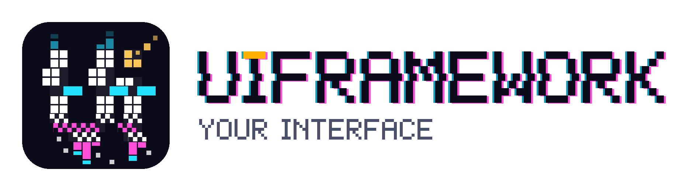
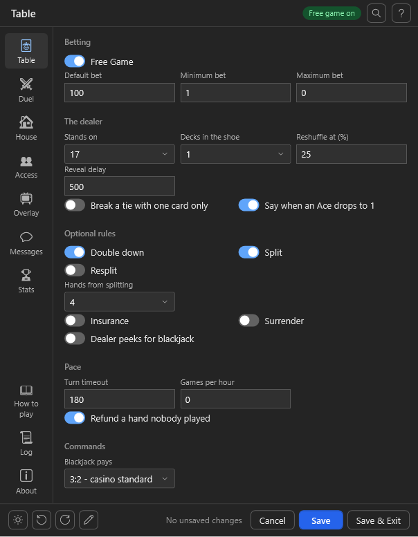
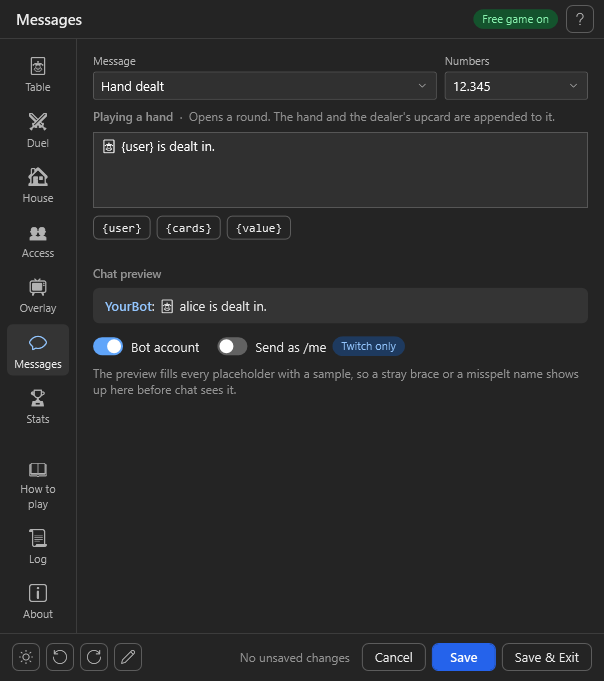
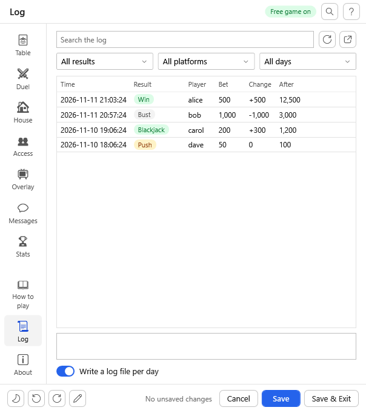
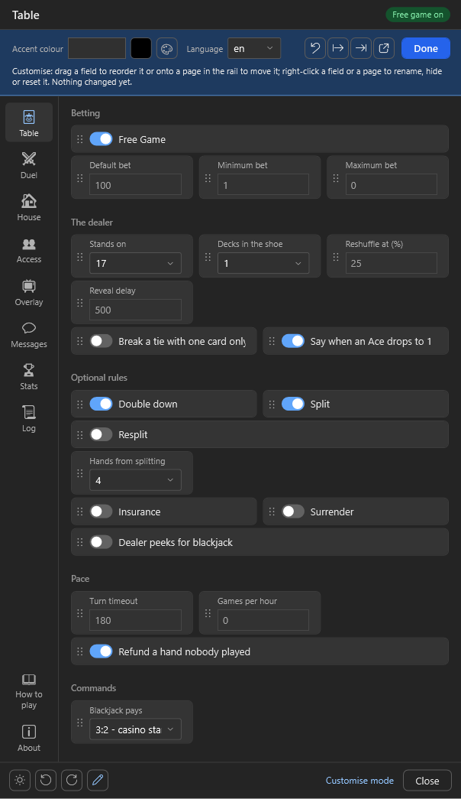
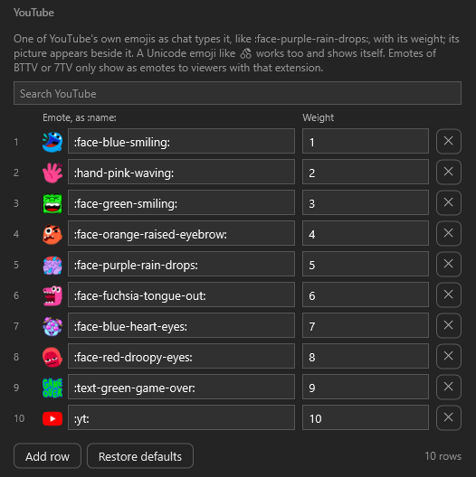

<p align="center">
  <picture>
    <source media="(prefers-color-scheme: dark)" srcset="assets/logo/uiframework-logo-dark.png">
    
  </picture>
</p>

<h1 align="center">UIFramework for streamer.bot</h1>

<p align="center">
  <b>One settings window for every Streamer.bot extension.</b><br>
  Declare your settings once, get pages, validation, three languages and a customise mode for free.
</p>

<p align="center">
  
  
  
  
  <br>
  <a href="https://github.com/aaskjer/UIFramework-Streamer.bot/releases"></a>
  
  <a href="https://github.com/aaskjer/UIFramework-Streamer.bot/releases"></a>
  <a href="https://github.com/aaskjer/UIFramework-Streamer.bot/actions/workflows/ci.yml"></a>
  
  
</p>

<p align="center">
  <a href="https://github.com/aaskjer/UIFramework-Streamer.bot/releases"><b>Download</b></a> &nbsp;·&nbsp;
  <a href="docs/Getting-Started.md"><b>Getting Started</b></a> &nbsp;·&nbsp;
  <a href="docs/Schema.md"><b>Schema</b></a> &nbsp;·&nbsp;
  <a href="docs/Conventions.md"><b>Conventions</b></a> &nbsp;·&nbsp;
  <a href="examples/DemoGame"><b>Demo Game</b></a> &nbsp;·&nbsp;
  <a href="CHANGELOG.md"><b>Changelog</b></a>
</p>

<p align="center">
  
  
  
</p>

---

## 📖 Overview

UIFramework is a settings-window framework for Streamer.bot extensions: one DLL that fetches and updates itself,
one look for every project that uses it, and pages built from data the project declares. Your action declares
its settings in a table, one line each; the framework draws the window, checks what is typed, saves the file and
asks your action whenever a button needs an answer. Nothing to install: the settings action downloads the DLL on
first use, checked against its published SHA-256, and offers new releases when the window opens.

## ✨ Highlights

- 🧱 **Pages from a table.** Numbers, percents, durations, dropdowns and sliders, switches, name and group chips,
  colours, paths, emotes with their pictures, chat messages with a live preview, and lists edited in place like a
  spreadsheet. Fields can follow a dropdown, grey out or hide on a condition.
- 🔘 **Buttons your game answers.** A test round, a preset, an OBS setup or a source check runs in your own code
  and answers with lines, a panel, emote pictures or values for other fields.
- 🌍 **English, German, Spanish, and more.** Common settings, pages and the window's own texts come translated in
  every language the framework has a file for; the game adds its own words with `Lang`. A new language is one JSON
  file, in the DLL or in `UIFramework\lang\` beside Streamer.bot.
- 🎨 **A customise mode.** Users rename, reorder, hide and move pages and fields by drag and drop, and pick the
  theme and accent colour, and choose help as a line under each field instead of a tooltip. All of it lives in `uiframework.layout.json` and survives every import of the game;
  `Lock()` turns the mode off for a game that wants its window exactly as declared.
- 📜 **Log, help and about pages.** A filterable log reader for the game's log files, a help page from your
  notes and commands, an about page with your links. Mistakes in the schema sit behind a red **i** in the header.
- 🔔 **Tells you about updates.** Once per Streamer.bot start, one notice names new releases of the games and of
  UIFramework: in every connected chat, or as a Windows notification while no broadcaster account is connected.
  Games choose the texts and ways; a switch on the About page turns it off.
- 🔄 **Updates itself.** The stub fetches the DLL, verifies it and asks before using a newer release;
  `"autoUpdate": false` turns the check off.

<p align="center">
  
  
</p>

## 🎮 Built on it

| Game | |
|---|---|
| [Blackjack Game](https://github.com/aaskjer/Blackjack-Game) | Solo, duels and House Mode with a real shoe and an OBS table |
| [Battleship Game](https://github.com/aaskjer/Battleship-Game) | Solo battles, chat battles and duels with a Click to Fire overlay |
| [Slot Machine Game](https://github.com/aaskjer/Slot-Machine-Game) | Emote reels on Twitch, YouTube and Kick, with a jackpot pool |
| [Classic Chat Gamble](https://github.com/aaskjer/Classic-Chat-Gamble) | The classic gamble with tunable odds and a free game mode |
| [Trivia Game](https://github.com/aaskjer/Trivia-Game) | Questions from opentdb, Wikidata, OdeNet, PokeAPI, IGDB or your own list |
| [Hangman Game](https://github.com/aaskjer/Hangman-Game) | Hangman for the whole chat, with word imports and an overlay |
| [RhymeTime](https://github.com/aaskjer/RhymeTime) | Find the rhyme, alone or as a chat battle |
| [High-Low Game](https://github.com/aaskjer/High-Low-Game) | Higher or lower, with a scoreboard |

## 🚀 Use it in your own project

Two files, nothing to install: [docs/Getting-Started.md](docs/Getting-Started.md) sets up the demo game step by
step, each step with the ready file to paste, then shows how to make it your own;
[examples/DemoGame](examples/DemoGame) is the result.

1. Paste the host block from `stub/HostSchema.cs` into your game's action, right below its usings (it needs none
   of its own), fill in its table (one line per setting) and its window (title, pages, help).
2. Call `UiHost.Handle(args, CPH, ...)` first thing in `Execute()`; it answers the settings window.
3. Make a second action from `stub/Stub.cs`, put your game action's name into `GameActionName`, give it a
   trigger. The window opens with pages, validation, a customise mode, export/import and self-updates.

[docs/Getting-Started.md](docs/Getting-Started.md#what-your-users-get-on-their-machine) also says what your users
get on their machine: the first download, the update question and how to turn it off.
[docs/Schema.md](docs/Schema.md) lists every kind of setting and every part of the window declaration,
[docs/Loader.md](docs/Loader.md) how the stub fetches and updates the DLL, [docs/Customize.md](docs/Customize.md)
what users can change, [docs/Conventions.md](docs/Conventions.md) the keys and texts every window knows.

## 🧩 How it fits together

1. **Conventions** (`conventions/keys.json`, `conventions/lang/*.json`, inside the DLL): known keys, standard
   pages, translations, theme defaults. [docs/Conventions.md](docs/Conventions.md) lists them and explains how to
   add a language.
2. **The game's schema:** its settings and its window, answered on request through its host block.
3. **The settings action:** the generic stub, the same file in every project.
4. **`uiframework.layout.json`** next to the settings file: the user's changes. Survives every import.

## 🛠️ Development

`dotnet build UIFramework.slnx` builds the DLL, the tests and the preview; `dotnet test` runs the 199 tests.
`src/UIFramework.Preview/bin/Debug/net48/UIFramework.Preview.exe` opens a Blackjack-shaped sample window, or with
`-schema hosts/<game>/schema.json` the window a game declares. `-theme dark` or `light`, `-shots <folder>` renders
every page to PNG, `-windowshots <folder>` the whole window per page at the page's full height (`-pages`, `-names`),
`-settle 3000` waits that long for emote pictures, `-pick 1` picks the first row of every grid.
A tag `vX.Y.Z` with its section in [CHANGELOG.md](CHANGELOG.md) publishes the DLL and updates `lib/v1/latest.json`,
which every stub reads. [PLAN.md](PLAN.md) (German) holds what is still open and the plan for the projects that are not games,
[docs/Phase0-Konventionen.md](docs/Phase0-Konventionen.md) (German) the conventions drawn from the game windows
this replaces.

```
src/UIFramework          the DLL (.NET Framework 4.8, WPF)
src/UIFramework.Tests    xUnit
src/UIFramework.Preview  opens the window without Streamer.bot
stub/                    Stub.cs, the generic settings action (loader + bridge); HostSchema.cs, the host block a
                         game pastes in
examples/DemoGame/       the smallest game with a window: DemoGame.cs, DemoGame.sb (the import), schema.json, a README
hosts/<name>/            schema.json of each game (what it answers, with the window) and HostBlock.cs, its host
                         block as the game carries it
conventions/             keys.json, lang/<code>.json and emotes/, embedded into the DLL
tools/                   update-host-block.ps1 (refresh the block in a game, keeping its table), check-stub.ps1
                         (compile the stub and the demo the Streamer.bot way), build-import.ps1 (keep an export's
                         code on the files), spec-to-window.ps1 (an old spec.json as a window declaration),
                         conventions-doc.ps1 (the tables in docs/Conventions.md),
                         update-twitch-emotes.ps1 (Twitch's global emotes for conventions/emotes)
lib/v1/latest.json       what the loader reads: version, download url, sha256
docs/                    Getting-Started, Schema, Conventions, Loader, Customize, Phase0-Konventionen (German);
                         images/ the screenshots
```

---

## Credits

- **Author:** [aaskjer on Twitch](https://twitch.tv/aaskjer) · [aaskjer.github.io](https://aaskjer.github.io/)
- **Built for:** [Streamer.bot](https://streamer.bot) by [nate1280](https://www.patreon.com/c/nate1280/home)
- **Uses:** [Newtonsoft.Json](https://www.newtonsoft.com/json) (MIT)
- **Licence:** MIT, see [LICENSE](LICENSE)
- **Thanks:** YOU ♡
