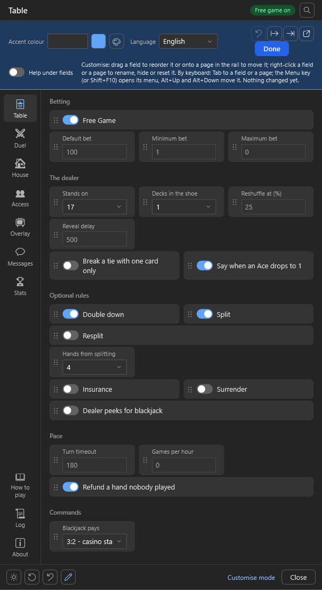
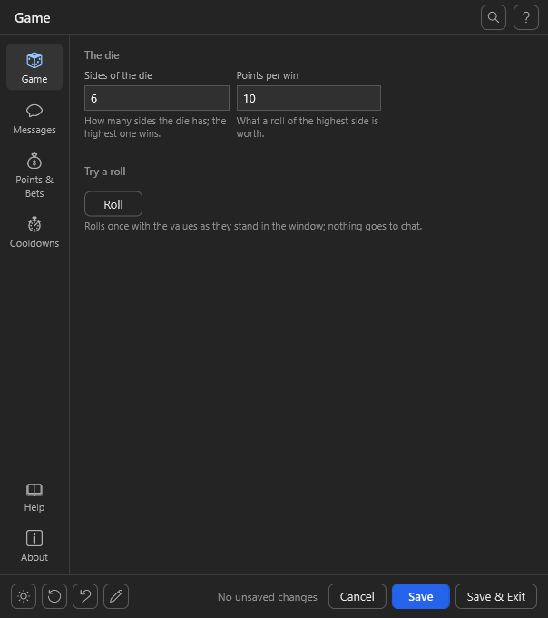

# Customise mode and the layout file

The pen button at the bottom left turns the customise mode on. In it the window can be rearranged without
touching a script; every change lands at once in `uiframework.layout.json` next to the settings file and
survives every import of the host.

A game can lock its layout with `Lock()` on its window (see [Schema.md](Schema.md)): then there is no pen button
and the window looks the way the game declares it, whatever the layout file says. Theme and language stay the
user's.

<p align="center"></p>
<p align="center"><sub>The customise mode: a handle on every field, the bar with accent colour, language and the layout buttons.</sub></p>

## In the mode

- **Fields** have a handle `⋮⋮`. The page shows them where they sit in the window, side by side where the window
  puts them so. Dropping a field at the left or right edge of another puts it beside that one, on the same line
  (an accent edge shows which side); at its top or bottom half, above or below it on a line of its own. Over a
  heading or a gap it lands between, under the last field at the end; at the edge the page scrolls along slowly.
  A field dropped among the fields of another section joins that section, so no heading shows twice.
  Dropping on a page in the rail moves it there. Right-click: *Rename*, *Hide* / *Show*, *Move to page*,
  *Move up*, *Move down*, *Reset this field*. Values are not editable in the mode.
- **Pages** in the rail: dragging sorts the top group; right-click: *Rename*, *Change icon* (an emoji or a
  conventions name like `gear`, `dice`, `coins`; a name the window does not know shows a dot), *Hide* / *Show*,
  *Move up*, *Move down*, *Reset this page*. `About` cannot be hidden; *How to play*, *Log* and *About* stay at the
  foot of the page list.
- **Without the mouse:** Tab reaches every field and every page. The Menu key (or Shift+F10) opens its menu;
  Alt+Up and Alt+Down move it one place, and it keeps the keyboard, so it can be moved on. In the rail, Up and
  Down go along the pages and Enter or Space opens one, in and out of the mode.
- **Hidden things** are shown half-transparent with the note `hidden` in the mode, so they can be shown again.
  A hidden field keeps its value in the settings file.
- **The bar at the top**, one row: the accent colour (blue buttons, switches that are on, the active page in
  the rail, links, the bar itself; for every UIFramework window of this Streamer.bot; taken once the picker
  closes or the typing pauses; a hex code `#RRGGBB` or `#RGB`, or a colour's name such as `red`, `blue`, `yellow`;
  a code with an alpha is not taken), the language (by its name: English, Deutsch, Español …), then four icon buttons named by their tooltips: *Reset
  layout* (every renamed, moved and hidden page and field and the help under the fields; the theme and the
  language stay; greyed while there is nothing to take back), *Export* and *Import* of the settings (see
  docs/Schema.md), *Open file* (the layout file); then *Done*. Under them: the switch *Help under fields* (each
  field's help as a small line under it instead of in its tooltip, for every UIFramework window of this game, the
  Messages page's switches and the Log page's included; a window the game locked has a bulb in its footer for it)
  and the hint with the count of changes, the switch among them.
- **Messages:** the templates can be sorted, renamed and hidden on their page; they cannot be dragged to
  another page.

After every change the window's content is rebuilt in place, on the same page and at the same scroll position;
the window itself stays where it is.

<p align="center"></p>

## The file

```json
{
  "theme": { "dark": true, "rainbow": false, "accent": "#7C3AED" },
  "language": "de",
  "autoUpdate": true,
  "helpLines": true,
  "pages": {
    "table": { "title": "Tisch", "icon": "cards", "order": 10 },
    "duel":  { "hidden": true }
  },
  "fields": {
    "useBot":         { "page": "table", "order": 0, "label": "Bot sends" },
    "dealerStandsOn": { "hidden": true },
    "numDecks":       { "page": "house", "section": "Shoe" }
  }
}
```

| Key                            | Meaning                                                                      |
|--------------------------------|------------------------------------------------------------------------------|
| `theme.dark`                   | dark (`true`) or light; missing: dark                                        |
| `theme.rainbow`                | rainbow mode, for one open only                                              |
| `theme.accent`                 | the accent colour, `#rrggbb` or a name (`red`); empty: the default blue      |
| `language`                     | `en`, `de`, `es` or a language from `UIFramework\lang\`: the window's own texts (buttons, status line, dialogs, menus, the Messages, Log and About pages' chrome), the labels and help of the conventions' keys, and the declared sections, page titles, pills, option labels and message groups the conventions or the game translate (docs/Schema.md, *Languages*); missing: `en`. What nothing translates stays as declared; the lines of the help and about pages translate through the game's `Tx` |
| `autoUpdate`                   | `false`: the loader no longer asks about new versions when this game's window opens. For every game at once it goes into `<Streamer.bot>\UIFramework\loader.json` (docs/Loader.md) |
| `updateNotices`                | `false`: this game is left out of the update notice once per Streamer.bot start (the switch *Tell me about updates* on its About page; docs/Schema.md, *Update notice*); missing: on |
| `helpLines`                    | `true`: each field's help is a line under it instead of its tooltip (*Help under fields* in the bar); missing: tooltips |
| `skipVersion`                  | where a settings action before 0.3.0 kept a skipped version, for this game alone; still read. From 0.3.0 on it is kept once for every game, in `<Streamer.bot>\UIFramework\loader.json` |
| `frameworkAvailable`           | set when the update dialog is answered "not now": the window shows this version as a pill in the header until it is taken or skipped |
| `pages.<id>.title`, `.icon`    | how the page is shown                                                        |
| `pages.<id>.order`             | the order in the top group; pages with an `order` come first                 |
| `pages.<id>.hidden`            | the page is gone (except `about`)                                            |
| `fields.<key>.page`            | which page the field belongs to                                              |
| `fields.<key>.order`           | the order within the page                                                    |
| `fields.<key>.row`             | the line the field sits on, beside the fields with the same name; `""` puts it on a line of its own, out of a row the game declared |
| `fields.<key>.label`, `.section` | the label, the section heading                                             |
| `fields.<key>.hidden`          | the field is gone; the value stays in the settings file                      |

A value of the wrong type (`"order": "2"`, `"theme": "dark"`) is read as not set. A file that is not JSON at all
is copied to `uiframework.layout.json.broken`, named in the log, and the window starts from the defaults. A file
another program holds open while the window reads it is tried again a few times; if it still cannot be opened,
the window starts from the defaults for once and does not write over it.

Dropping a field at the top or bottom of a field that shares a line with others puts it above or below that whole
line; the row stays together.

The layout file is the fourth and last layer over the conventions, the schema and the window declaration. Keys
the schema no longer knows are ignored. Editing by hand is fine; the window reads the file on every open.
