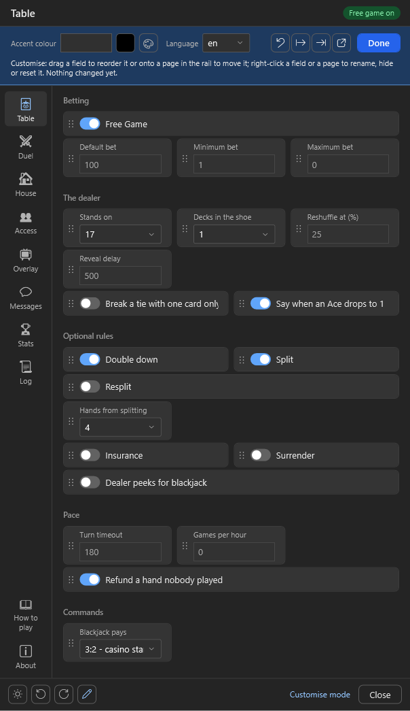
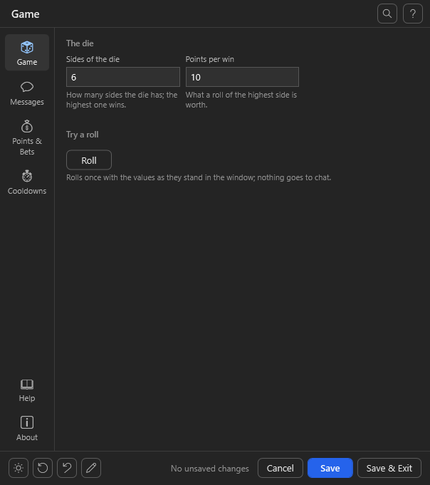

# Customise mode and the layout file

The pen button at the bottom left turns the customise mode on. There the window can be rearranged without
touching a script. Every change lands at once in `uiframework.layout.json` next to the extension's settings file
and survives importing the extension again.

An extension can lock its layout (`Lock()` on its window, see [Schema.md](Schema.md)). A locked window has no pen
button, and with it no export and import. It looks the way the extension declares it, whatever the layout file
says about pages, fields and the accent colour. Dark or light theme, the language and the help under the fields
stay the user's.

<p align="center"></p>
<p align="center"><sub>The customise mode: a handle on every field, the bar with accent colour, language and the layout buttons.</sub></p>

## In the mode

- **Fields** have a handle `⋮⋮`. The page shows them as the window places them, side by side where they share a
  line. Dropped on the left or right edge of another field, a field goes beside it on the same line (an accent
  edge shows which side); dropped on its top or bottom half, above or below it on a line of its own. Over a
  heading or a gap it lands between the fields there, below the last field at the end. Near the top or bottom
  edge the page scrolls slowly along. A field dropped among the fields of another section joins that section, so
  no heading shows twice. Dropped on a page in the rail, it moves there as *Move to page* moves it: behind the last
  field of its own section there, else to the end of the page, on a line of its own if it sat in a row. About,
  Help, Log, Messages and pages the extension draws itself take no fields; *Move to page* leaves them out too.
  Right-click: *Rename*, *Hide* / *Show*, *Move to page*, *Move up*, *Move down*, *Reset this field*. Values cannot
  be edited in the mode.
- **Pages** in the rail: dragging sorts the top group. Right-click: *Rename*, *Change icon* (an emoji, or a name
  like `gear`, `dice`, `coins`; a name the window does not know shows a dot), *Hide* / *Show*, *Move up*,
  *Move down*, *Reset this page*. *About* cannot be hidden. *Help* (*How to play* in the games), *Log* and *About*
  stay at the foot of the page list, under any page the extension puts there.
- **Without the mouse:** Tab reaches every field and every page. The Menu key (or Shift+F10) opens its menu;
  Alt+Up and Alt+Down move it one place and leave the keyboard on it, so it can be moved further. A field next to a
  section heading crosses it in one step, by key or menu alike: the first field of a section moves up into the
  section above, the last one down into the next. In the rail, Up and Down step through the pages and Enter or
  Space opens one, in the mode and outside it.
- **Hidden things** stay in view in the mode, half-transparent, so they can be shown again: a hidden field with
  the note `hidden`, a hidden page in the rail. Fields the extension hides by itself are among them and can be
  shown the same way. A hidden field keeps its value in the settings file.
- **The bar at the top** holds, in one row, the accent colour, the language, four icon buttons named by their
  tooltips, and *Done*. The accent colour tints the blue buttons, switches that are on, the active page in the
  rail, links and the bar itself. It holds for this extension's windows, since it is kept in the extension's
  layout file, and is taken once the picker closes or typing pauses: a hex code `#RRGGBB` or `#RGB`, or a
  colour's name such as `red`, `blue`, `yellow`; a code with an alpha is not taken. The language is picked by its
  own name (English, Deutsch, Español, Français, Português (Brasil) …). The buttons: *Reset layout* takes back
  every renamed, moved and hidden page and field, every changed icon and the help under the fields, while the
  theme, the accent colour and the language stay; it is greyed while there is nothing to take back. *Export* and
  *Import* handle the settings (see docs/Schema.md), *Open file* opens the layout file. Under the row sit the
  switch *Help under fields* and the hint with the number of changes, the switch counted among them. The switch
  shows each field's help as a small line under it instead of in its tooltip, the switches on the Messages and
  Log pages included, for every window of this extension; a locked window has a bulb in its footer for it.
- **Messages:** the templates can be sorted, renamed and hidden on their page; they cannot be dragged to
  another page.

After every change the window's content is rebuilt in place, on the same page and at the same scroll position.
A change that concerns another page (a field moved there, a page renamed or moved in the rail) brings that page up
instead. The window itself stays where it is.

<p align="center"></p>

## The file

```json
{
  "theme": { "dark": true, "rainbow": false, "accent": "#7C3AED" },
  "language": "de",
  "autoUpdate": true,
  "helpLines": true,
  "pages": {
    "table": { "title": "Tisch", "icon": "cards", "order": 10 },
    "duel":  { "hidden": true }
  },
  "fields": {
    "useBot":         { "page": "table", "order": 0, "label": "Bot sends" },
    "dealerStandsOn": { "hidden": true },
    "numDecks":       { "page": "house", "section": "Shoe" }
  }
}
```

| Key                            | Meaning                                                                      |
|--------------------------------|------------------------------------------------------------------------------|
| `theme.dark`                   | dark (`true`) or light; missing: dark                                        |
| `theme.rainbow`                | rainbow mode, for one open only                                              |
| `theme.accent`                 | the accent colour, `#rrggbb` or a name (`red`); empty: the default blue      |
| `language`                     | `en`, `de`, `es`, `fr`, `pt-BR` or a language from `UIFramework\lang\`: the window's own texts (buttons, status line, dialogs, menus, the Messages, Log and About pages' own texts), the labels and help of the framework's standard settings, and the declared sections, page titles, pills, option labels and message groups that the framework or the extension translates (docs/Schema.md, *Languages*). The code is matched in any case; a regional code falls back to its language (`de-AT`: `de`) and a language to its only regional file (`pt`: `pt-BR`). Missing, or a code that matches none: `en`. What nothing translates stays as declared; the lines of the help and about pages translate through the extension's `Tx` |
| `autoUpdate`                   | `false`: the loader no longer asks about new versions when this extension's window opens. For every extension at once it goes into `<Streamer.bot>\UIFramework\loader.json` (docs/Loader.md) |
| `updateNotices`                | `false`: this extension is left out of the update notice that comes once per Streamer.bot start (the switch *Tell me about updates* on its About page; docs/Schema.md, *Update notice*); missing: on |
| `helpLines`                    | `true`: each field's help is a line under it instead of its tooltip (*Help under fields* in the bar); missing: tooltips |
| `tourSeen`                     | `true`: the window's tour has been shown and no longer starts by itself (the **?** at the top right still shows it); `false` or missing: it starts on the next open |
| `skipVersion`                  | where a settings action before 0.3.0 kept a skipped version, for this extension alone; still read. From 0.3.0 on it is kept once for every extension, in `<Streamer.bot>\UIFramework\loader.json`, and lands here only when that file cannot be read or written |
| `frameworkAvailable`           | set when the update dialog is answered "not now" or the download fails: the window shows this version as a pill in the header until it is taken or skipped |
| `pages.<id>.title`, `.icon`    | how the page is shown                                                        |
| `pages.<id>.order`             | the order in the top group; pages with an `order` come first                 |
| `pages.<id>.hidden`            | the page is gone (except `about`)                                            |
| `fields.<key>.page`            | which page the field belongs to                                              |
| `fields.<key>.order`           | the order within the page. On a page with orders, a field that has none (new in an update, or given back by *Reset this field*) goes behind the field the extension declares before it. When that field sits in another section, it goes to the end of its own section instead, or to the end of the page when the page lacks that section |
| `fields.<key>.row`             | the line the field sits on, beside the fields with the same name; `""` puts it on a line of its own, out of a row the extension declared |
| `fields.<key>.label`, `.section` | the label, the section heading                                             |
| `fields.<key>.hidden`          | `true`: the field is gone, its value stays in the settings file; `false`: a field the extension hides is shown |

A value of the wrong type (`"order": "2"`, `"theme": "dark"`) is read as not set. A file that is not JSON at all
is copied to `uiframework.layout.json.broken`, named in the log, and the window starts from the defaults. A file
another program holds open while the window reads it is tried again a few times; if it still cannot be opened,
the window starts from the defaults this once and does not write over it.

Dropped on the top or bottom half of a field that shares a line with others, a field goes above or below that
whole line, so the row stays together.

The layout file is the fourth and last layer, laid over the framework's conventions, the extension's schema and
its window declaration. Entries for fields or pages the extension no longer has are ignored. The file can be
edited by hand; the window reads it on every open.
