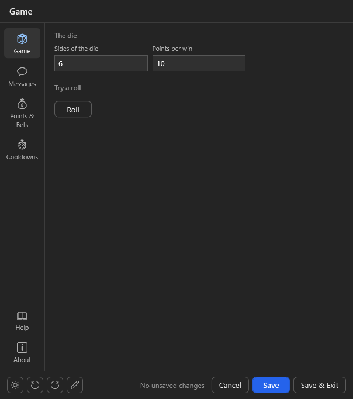
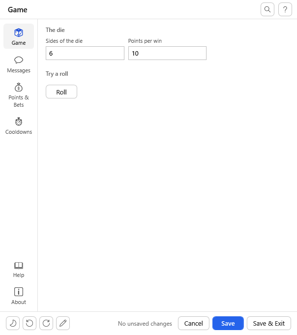
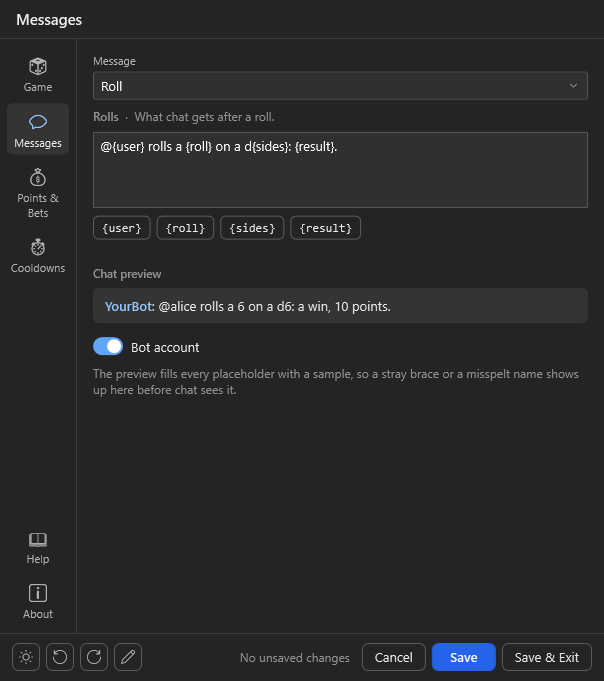

# Getting started: a settings window for your own Streamer.bot project

Ten minutes from a game that reads a JSON file to a settings window with pages, validation, a customise mode and
automatic updates of the window itself. Nothing to install: the settings action fetches `UIFramework.dll` on
first use and keeps it current.

You need two actions in Streamer.bot. `examples/DemoGame` has both as files and as an import (`DemoGame.sb`);
everything below is what they do.

## 1. The game action gets the host block

Paste the block from [`stub/HostSchema.cs`](../stub/HostSchema.cs) (everything between
`// --- UIFramework host block` and `// --- end UIFramework host block ---`) at the end of your action's code,
after your `CPHInline` class. It needs no reference beyond Newtonsoft.Json, which every action has, but it does
need these usings at the top of the action's code (Streamer.bot's template has only some of them):

```csharp
using System;
using System.Collections.Generic;
using System.Globalization;
using System.IO;
using System.Linq;
using Newtonsoft.Json;
using Newtonsoft.Json.Linq;
```

Fill in the two spots marked in it:

**The table**, one line per setting your game reads (`// __TABLE__`):

```csharp
public static readonly Setting[] Table =
{
    S("useBot", true),
    S("globalCooldown", 10),
    S("sides", 6, page: "game", label: "Sides of the die", help: "The highest one wins.", section: "The die", min: 2, max: 100),
    S("tryRoll", null, page: "game", label: "Roll", kind: "action", section: "Try a roll", live: true, panel: true),
    Msg("Rolls", "msgRoll", "@{user} rolls a {roll}: {result}.", "Roll", "What chat gets.", new[] { "user", "roll", "result" }),
};
```

Keys the framework knows (`useBot`, `globalCooldown`, `userCooldown`, `blockedUsers`, ... see
[`conventions/keys.json`](../conventions/keys.json)) need only their default: label, help, page and limits come
with them. `S(key, default, ...)` takes everything else as named arguments; `Msg(...)` is a chat message with
placeholders. [docs/Schema.md](Schema.md) lists every argument and kind (numbers, switches, dropdowns, sliders,
colours, paths, emotes, lists with a row editor, buttons that ask your game something).

**The window** (`// __WINDOW__`), as much or as little as you like:

```csharp
public static readonly UiWindow Window = new UiWindow("Demo Game", releases: "you/your-repo")
    .Pages(P("game", "Game", "dice"), "messages", "help", "about")
    .Cooldowns(C("364c549b-0294-486b-80ae-ea838e14ec18", "globalCooldown", "userCooldown"))
    .Help(H("Playing", Cmd("!roll", "Rolls the die once.")))
    .About(credits: "By you.");
```

`Cooldowns` is how the cooldown settings reach the command: after every save the settings action sets the
`!roll` command's global and per-user cooldown in Streamer.bot from those two keys. Without it they are just
numbers in the file. The command is named by its id (right-click it in Streamer.bot, *Copy Id*); an export and
import keep the id, so this is what to ship. For a command made by hand its text (`"!roll"`) works too.

`releases` is your GitHub repository: it gives the About page its links and the window its "new version of the
game" check.

## 2. The game action answers the window

First thing in `Execute()`:

```csharp
if (UiHost.Handle(args, CPH, ActionName, "demo", CurrentVersion, SettingsFile,
        test: (name, s) => name == "tryRoll" ? Roll(s, "alice") : null))
    return true;
```

Keep the code the game action's **last sub-action**, with nothing before it that acts. The window runs the whole
action for each of its requests, and a sub-action after the code still runs once `Handle` has answered and the
code returned `true`: a chat message or a sound there would go out every time the window asks something.

`ActionName` is this action's exact name in Streamer.bot, `SettingsFile` the settings file relative to the
Streamer.bot folder (`"Demo Game/DemoGame-Settings.json"`); the window writes it, your game reads it with
`UiSettings.Load(path, CPH.LogWarn)` and `s.Int("sides")`, `s.Bool("useBot")`, `s.String("msgRoll")` (a damaged
file gives the backup of the last save, and the log says so). The optional delegates
are how the window talks to your game: `test` answers a Try button or a live field, `validate` checks before a
save, `saved` runs after one, `table` and `emotes` fill special fields. All are optional; a game with plain
settings passes none.

**The window waits five seconds for an answer.** The settings action runs your game action with
`CPH.RunAction(..., true)` and waits; a request it has given up on is skipped, not run late. One that has started
gets 30 seconds more, then the window stops waiting and goes on without its answer. So inside `test`,
`validate`, `saved`, `table` and `emotes`:

- Do not call `CPH.RunAction(other, true)` on an action that sits in the same **blocking** action queue as the
  settings action or your game action: it cannot start until they end, which is after the five seconds, and the
  window shows "no answer" (for a save: asks whether to save unchecked). Run such work with
  `CPH.RunAction(other, false)`, or keep the game action and the settings action out of blocking queues.
- Keep it short: no `CPH.Wait`, no web requests. Work that takes long goes into `saved` with `RunAction(..., false)`
  or into the game's own run.

## 3. The settings action is the stub, unchanged

Make a second action, paste [`stub/Stub.cs`](../stub/Stub.cs) as its Execute Code and change its one line:

```csharp
private const string GameActionName = "Demo Game";
```

Nothing to add to the action's references. Give it a trigger: a command, a hotkey, a button in a deck.

That is all. Run the settings action: the first time it asks whether to download `UIFramework.dll` into
`<Streamer.bot>\UIFramework\lib\`; then the window opens with your pages, a Messages page with a chat preview,
Help and About, a customise mode (the pen) and export/import. Whenever a newer framework is released, the stub
offers it on the next open ([docs/Loader.md](Loader.md)).

<p align="center">
  
  
  
</p>
<p align="center"><sub>The demo game's window: its own page in both themes, and the Messages page the framework adds.</sub></p>

## Points

A game that pays out declares `S("pointsVariable", "points")` and `S("pointsName", "Points")` and asks
`UiCurrency.Detect(CPH, settings)` on every run: when the streamer runs StreamUP's Currency Core or Tawmae's
LOYALTY POINTS, `Variable` and `Name` come from there and the window shows a pill saying so; otherwise the two
settings apply. The demo pays a win into that variable with `CPH.GetTwitchUserVarById`/`SetTwitchUserVarById`
(YouTube and Kick likewise).

## What you get without writing it

- Pages from the table, sections where `section` changes, numbers three to a line, switches two.
- Validation: limits, a `requires` that greys a field out, your `validate` answer before a save.
- A Messages page with placeholder chips and a live preview, sender switches, a cooldown group.
- A Log page that follows your log folder as the game writes it (`.Log(folder, files)` in the window).
- Reset to defaults, per page or all; unsaved-change tracking; dark and light theme; an accent colour.
- The customise mode: users rename, move and hide fields and pages, in `uiframework.layout.json` next to the
  settings file, surviving every import of your game ([docs/Customize.md](Customize.md)).
- Export and import of the settings.
- A banner, and a highlighted list on top of the Log page (on About when there is none), when the table or the
  window declares something the framework cannot use (an unknown kind, a requirement on a key that is not there),
  so you see it without reading Streamer.bot's log.

## What your users get on their machine

This is what to tell a streamer who imports your game, or link them here:

- **First open:** the settings action asks whether to download `UIFramework.dll` from this repository's
  release into `<Streamer.bot>\UIFramework\lib\`. The file is checked against its published SHA-256 before it
  is used. *No* opens that folder so they can put the DLL there themselves; *Cancel* leaves everything as it is.
- **Updates:** when a newer framework release is out, the window asks before it downloads anything. *Cancel*
  skips that version for good, *No* shows it as a pill in the window's header until it is taken.
- **Turning the update check off:** `"autoUpdate": false` in `uiframework.layout.json`, the file next to your
  game's settings file (`settingsFile`, relative to the Streamer.bot folder). When the file is not there yet,
  `{ "autoUpdate": false }` is all it needs. The window then opens with the DLL it has and asks nothing.
- **Without the window:** your game action never loads the DLL; only the settings action does. With the
  settings action disabled the game plays on with its settings file, which can still be edited by hand.

[docs/Loader.md](Loader.md) has the details: where `latest.json` comes from, the hash on every load, what
happens offline.

## Keeping up

The host block is the same in every game. When a new framework release changes it, run

```powershell
tools\update-host-block.ps1 -File "C:\...\YourGame.cs"
```

which swaps the block and keeps your Window and Table. It keeps a copy of the file as `.bak` before it writes,
and it refuses (and writes nothing) when the old block holds lines of yours outside the Window and the Table,
which the swap would drop, or when the Table's end cannot be told for sure; `-Force` writes anyway, `-Check`
only tells whether the block is current. The settings action never changes per project; replace it
with the new `stub/Stub.cs` when a release says so.
