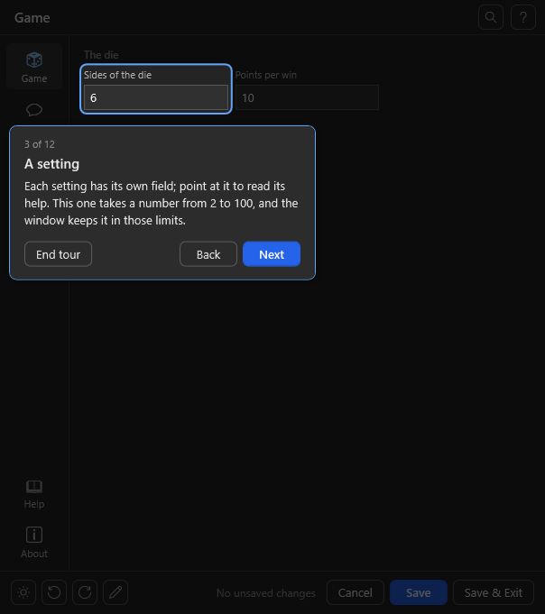

# Getting started

At the end of this page the **Demo Game** runs in your Streamer.bot: `!roll` in chat rolls a die, and a
settings window with pages, a Try button, a chat preview and a customise mode sets it up. Every step is copy and
paste of a ready file; nothing needs changing. Making it your own game comes after that, in
[Make it your own](#make-it-your-own).

| Step | In Streamer.bot | File to paste |
|------|-----------------|---------------|
| [1](#step-1-the-game-action-demo-game) | Action **Demo Game** | [`examples/DemoGame/DemoGame.cs`](../examples/DemoGame/DemoGame.cs) |
| [2](#step-2-the-command-roll) | Command `!roll` | – |
| [3](#step-3-the-settings-action-demo-game-settings) | Action **Demo Game Settings** | [`stub/Stub.cs`](../stub/Stub.cs) |
| [4](#step-4-open-the-window) | Open the window | – |
| [5](#step-5-play) | `!roll` in chat | – |

> **In a hurry?** *Import* in Streamer.bot, drop in [`examples/DemoGame/DemoGame.sb`](../examples/DemoGame/DemoGame.sb):
> that is steps 1 to 3 in one go (the settings action is called **.Demo GUI** there, the command **Run DemoGame**).
> The import brings the command switched off: tick *Enabled* on it in *Commands*, then go on with
> [step 4](#step-4-open-the-window).

**How to copy a file:** open its *raw* link (in each step below), press <kbd>Ctrl</kbd>+<kbd>A</kbd>,
<kbd>Ctrl</kbd>+<kbd>C</kbd>. On a file's GitHub page the *Copy raw file* button at the top right does the same.
Always the **whole** file: a part of it gives compile errors.

## Step 1: the game action `Demo Game`

File: [`examples/DemoGame/DemoGame.cs`](../examples/DemoGame/DemoGame.cs) ·
[raw](https://raw.githubusercontent.com/aaskjer/UIFramework-Streamer.bot/main/examples/DemoGame/DemoGame.cs)

1. *Actions* tab, right-click into the list of actions, *Add*. Name: `Demo Game`, exactly so: the settings
   action finds the game by this name.
2. Select the new action. Under *Sub-Actions*: right-click, *Add* → *Core* → *C#* → *Execute C# Code*.
3. In the code window, select all and delete it (Streamer.bot's template). Paste `DemoGame.cs`.
4. *Compile*: the log under the code reports no errors. Then *Save and Compile*.

Nothing to add under *References*. The file is the whole game: the UIFramework host block (the settings and the
window, declared once) right below the `using` lines, the game in the `CPHInline` class at the end.

## Step 2: the command `!roll`

1. *Commands* tab, right-click, *Add*. Name: `Demo roll`, command: `!roll`, *Enabled* ticked. *OK*.
2. Back on *Actions*, select **Demo Game**. Under *Triggers*: right-click, *Add* → *Core* → *Commands* →
   *Command Triggered*, and pick `Demo roll`.

Leave the command's cooldowns as they are: the settings window sets them from its own settings after every save
(10 seconds for everyone, 30 per viewer to begin with).

## Step 3: the settings action `Demo Game Settings`

File: [`stub/Stub.cs`](../stub/Stub.cs) ·
[raw](https://raw.githubusercontent.com/aaskjer/UIFramework-Streamer.bot/main/stub/Stub.cs)

1. *Actions*, *Add*. Name: `Demo Game Settings` (any name works here).
2. *Sub-Actions*: *Add* → *Core* → *C#* → *Execute C# Code*, select all, delete, paste `Stub.cs`.
   Change nothing: its line `private const string GameActionName = "Demo Game";` already names the action from
   step 1.
3. *Compile*, then *Save and Compile*. Nothing to add under *References*.
4. Give it a trigger that only you use, since it opens a window on your PC: a hotkey, a Stream Deck button, or a
   command (as in step 2) that only the broadcaster may run.

## Step 4: open the window

Fire the trigger from step 3. Without a hotkey or a deck at hand: right-click the trigger under *Triggers*,
*Test Trigger*.

- **The first time** a question comes up: download `UIFramework.dll` into `<Streamer.bot>\UIFramework\lib\<version>\`?
  *Yes*. The file is checked against its published SHA-256 before it is used.
- **The window opens with a tour** that rings one part after the other and says what it does: the pages, a
  setting, the *Roll* button that tries a roll without sending anything to chat, the *Messages* page with its
  placeholder chips and chat preview, saving, resetting, the theme and the customise mode. *Next* goes on, Esc
  ends it; it starts by itself only this once, the **?** at the top right shows it again. Your own game gets one
  with `.Tour(...)` in its window ([Schema.md](Schema.md#the-tour)).
- Change a value and save. The window writes `<Streamer.bot>\Demo Game\DemoGame-Settings.json` and sets the
  cooldowns of `!roll`.

<p align="center">
  
</p>

<p align="center">
  
  
  
</p>
<p align="center"><sub>The demo game's window: its own page in both themes, and the Messages page the framework adds.</sub></p>

## Step 5: play

Type `!roll` in your chat. The answer reads like `@you rolls a 4 on a d6: no luck.`; the highest side wins the
points per win, paid into the viewer's points (Currency Core's or LOYALTY POINTS' when one is installed, else the
user variable `points`).

### When something does not work

| You see | It is |
|---------|-------|
| Compile errors such as `The type or namespace name 'JObject' could not be found` | Only part of the file was pasted, or `HostSchema.cs` alone in a new action. Paste the whole `DemoGame.cs` (step 1). |
| The window says the action *ran but did not answer* | The game action is not named exactly `Demo Game`, its sub-action did not compile, or it is disabled. Streamer.bot's *Log* tab shows which. |
| The window never opens, no question either | The settings action did not run: check its trigger, and the log. |
| `!roll` gets no answer | The command is off, or not the trigger of **Demo Game** (step 2). A roll inside the cooldown is ignored too. |

## Make it your own

The demo becomes your game in `DemoGame.cs` (save it under your game's name) and one line of `Stub.cs`:

1. **Names.** In `CPHInline`: `ActionName` (your game action's name: the log lines carry it), `SettingsFile` (where the settings
   go, relative to the Streamer.bot folder), `CurrentVersion`, and the short host id `"demo"` in the
   `UiHost.Handle` call. In the settings action: `GameActionName`, the same name as `ActionName`.
2. **Settings,** in the `Table` near the top of the host block: one line per setting your game reads.

   ```csharp
   public static readonly Setting[] Table =
   {
       S("useBot", true),
       S("globalCooldown", 10),
       S("userCooldown", 30),
       S("sides", 6, page: "game", label: "Sides of the die", help: "The highest one wins.", section: "The die", min: 2, max: 100),
       S("tryRoll", null, page: "game", label: "Roll", kind: "action", section: "Try a roll", live: true, panel: true),
       Msg("Rolls", "msgRoll", "@{user} rolls a {roll}: {result}.", "Roll", "What chat gets.", new[] { "user", "roll", "result" }),
   };
   ```

   Keys the framework knows (`useBot`, `globalCooldown`, `userCooldown`, `blockedUsers`, ... see
   [`conventions/keys.json`](../conventions/keys.json)) need only their default: label, help, page and limits
   come with them. `S(key, default, ...)` takes everything else as named arguments; `Msg(...)` is a chat message
   with placeholders. [Schema.md](Schema.md) lists every argument and kind (numbers, switches, dropdowns,
   sliders, colours, paths, emotes, lists with a row editor, buttons that ask your game something).
3. **The window,** in `Window` just above the table, as much or as little as you like:

   ```csharp
   public static readonly UiWindow Window = new UiWindow("Demo Game", releases: "you/your-repo")
       .Pages(P("game", "Game", "dice"), "messages", "help", "about")
       .Cooldowns(C("!roll", "globalCooldown", "userCooldown"))
       .Help(H("Playing", Cmd("!roll", "Rolls the die once.")))
       .About(credits: "By you.");
   ```

   `releases` is your GitHub repository: it gives the About page its links, the window its "new version of
   the game" check, and your game a place in the update notice in chat once per Streamer.bot start. `Cooldowns` is how the cooldown settings reach the command: after every save the settings
   action sets its global and per-user cooldown from those two keys; without it they are just numbers in the
   file. Name the command by its text (`"!roll"`), its name, or its id (right-click the command in Streamer.bot
   to copy it). For a game you ship, the id is the safer one: an export and import keep it, and it still holds
   when a streamer renames the command.
4. **The game,** in `CPHInline`: read the settings with `UiSettings.Load(SettingsFile, CPH.LogWarn)` and
   `s.Int("sides")`, `s.Bool("useBot")`, `s.String("msgRoll")`. A damaged file gives the backup of the last save,
   and the log says so.

### A game you already have

1. Paste the host block from [`stub/HostSchema.cs`](../stub/HostSchema.cs)
   ([raw](https://raw.githubusercontent.com/aaskjer/UIFramework-Streamer.bot/main/stub/HostSchema.cs)), from
   `// --- UIFramework host block` to `// --- end UIFramework host block ---`, into your game action **right below
   its `using` lines**, as in `DemoGame.cs` and every game on UIFramework. It needs no usings of its own and no
   reference beyond Newtonsoft.Json, which every action has, so anywhere after the usings works as well (at the
   end, or inside the `CPHInline` class). It is not an action of its own: pasted alone into an Execute Code it
   does nothing.
2. Fill in its `Window` (`// __WINDOW__`) and `Table` (`// __TABLE__`) as above.
3. Three constants in `CPHInline`, then first thing in `Execute()` the call that answers the window:

   ```csharp
   private const string ActionName = "My Game";                          // your game action's name
   private const string SettingsFile = "Chat Games/My Game/settings.json"; // relative to the Streamer.bot folder
   private const string CurrentVersion = "v1.0.0";

   public bool Execute()
   {
       if (UiHost.Handle(args, CPH, ActionName, "mygame", CurrentVersion, SettingsFile))
           return true;
       var s = UiSettings.Load(SettingsFile, CPH.LogWarn);
       // ... the game, reading s.Int("..."), s.Bool("..."), s.String("...")
   }
   ```

4. The settings action as in [step 3](#step-3-the-settings-action-demo-game-settings), with your game action's
   name in `GameActionName`.

## Good to know

### The game action and the window

**Keep the code the game action's last sub-action**, with nothing before it that acts. The window runs the whole
action for each of its requests, and a sub-action after the code still runs once `Handle` has answered and the
code returned `true`: a chat message or a sound there would go out every time the window asks something.

`UiHost.Handle` takes optional delegates, the ways the window talks to your game: `test` answers a Try button or
a live field, `validate` checks before a save, `saved` runs after one, `table` and `emotes` fill special fields. A
game with plain settings passes none. The demo's Try button:

```csharp
if (UiHost.Handle(args, CPH, ActionName, "demo", CurrentVersion, SettingsFile,
        test: (name, s) => name == "tryRoll" ? Roll(s, UiCurrency.Detect(CPH, s), "alice", null) : null))
    return true;
```

**The window waits five seconds for an answer.** The settings action runs your game action with
`CPH.RunAction(..., true)` and waits; a request it has given up on is skipped, not run late. One that has started
gets 30 seconds more, then the window stops waiting and goes on without its answer. So inside `test`,
`validate`, `saved`, `table` and `emotes`:

- Do not call `CPH.RunAction(other, true)` on an action that sits in the same **blocking** action queue as the
  settings action or your game action: it cannot start until they end, which is after the five seconds, and the
  window shows "no answer" (for a save: asks whether to save unchecked). Run such work with
  `CPH.RunAction(other, false)`, or keep the game action and the settings action out of blocking queues.
- Keep it short: no `CPH.Wait`, no web requests. Work that takes long goes into `saved` with `RunAction(..., false)`
  or into the game's own run.
- An action you run from there runs as usual: the host block clears the window's arguments (`uiframework.request`
  and the others) before your handler runs. A host block older than UIFramework 1.2.0 does not; see
  [Loader.md](Loader.md) for the line to add then.

### Points

A game that pays out declares `S("pointsVariable", "points")` and `S("pointsName", "Points")` and asks
`UiCurrency.Detect(CPH, settings)` on every run: when the streamer runs StreamUP's Currency Core or Tawmae's
LOYALTY POINTS, `Variable` and `Name` come from there and the window shows a pill saying so; otherwise the two
settings apply. The demo pays a win into that variable with `CPH.GetTwitchUserVarById`/`SetTwitchUserVarById`
(YouTube and Kick likewise).

### What you get without writing it

- Pages from the table, sections where `section` changes, numbers three to a line, switches two.
- Validation: limits, a `requires` that greys a field out, your `validate` answer before a save.
- A Messages page with placeholder chips and a live preview, sender switches, a cooldown group.
- A Log page that follows your log folder as the game writes it (`.Log(folder, files)` in the window).
- Reset to defaults, per page or all; unsaved-change tracking; dark and light theme; an accent colour.
- The customise mode: users rename, move and hide fields and pages, in `uiframework.layout.json` next to the
  settings file, surviving every import of your game ([Customize.md](Customize.md)).
- Export and import of the settings.
- A red **i** in the header when the table or the window declares something the framework cannot use (an unknown
  kind, a requirement on a key that is not there) or something fails while the window is open: a click lists it
  all, with a *Copy* button for a bug report, so you see it without reading Streamer.bot's log. The pages stay clean.

### What your users get on their machine

This is what to tell a streamer who imports your game, or link them here:

- **First open:** the settings action asks whether to download `UIFramework.dll` from this repository's
  release into `<Streamer.bot>\UIFramework\lib\<version>\` (for example `lib\1.2.0\UIFramework.dll`). The file is
  checked against its published SHA-256 before it is used. *No* opens the `lib` folder so they can put the DLL there
  themselves, in a folder named after its version; *Cancel* leaves everything as it is.
- **Updates:** when a newer framework release is out, the window asks before it downloads anything. *Cancel*
  skips that version for good, *No* shows it as a pill in the window's header until it is taken.
- **Turning the update check off:** `"autoUpdate": false` in `uiframework.layout.json`, the file next to your
  game's settings file (`settingsFile`, relative to the Streamer.bot folder). When the file is not there yet,
  `{ "autoUpdate": false }` is all it needs. The window then opens with the DLL it has and asks nothing.
- **Without the window:** your game action never loads the DLL; only the settings action does. With the
  settings action disabled the game plays on with its settings file, which can still be edited by hand.

[Loader.md](Loader.md) has the details: where `latest.json` comes from, the hash on every load, what happens
offline.

### Keeping up

The host block is the same in every game. When a new framework release changes it, run

```powershell
tools\update-host-block.ps1 -File "C:\...\YourGame.cs"
```

which swaps the block and keeps your Window and Table. It keeps a copy of the file as `.bak` before it writes,
and it refuses (and writes nothing) when the old block holds lines of yours outside the Window and the Table,
which the swap would drop, or when the Table's end cannot be told for sure; `-Force` writes anyway, `-Check`
only tells whether the block is current. The settings action never changes per project; replace it with the new
`stub/Stub.cs` when a release says so.
