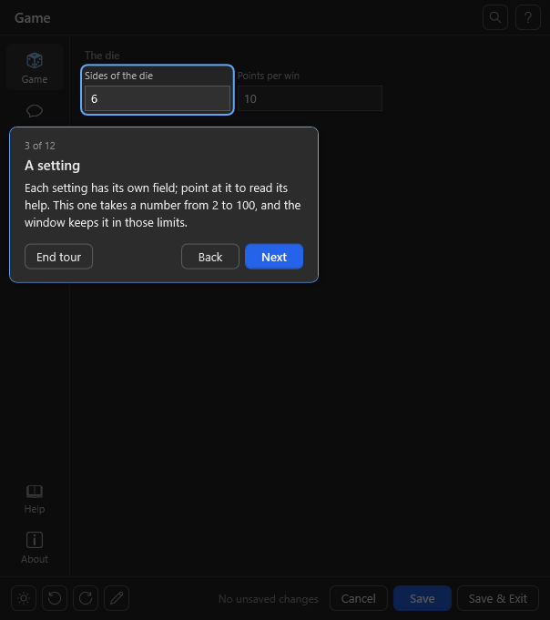
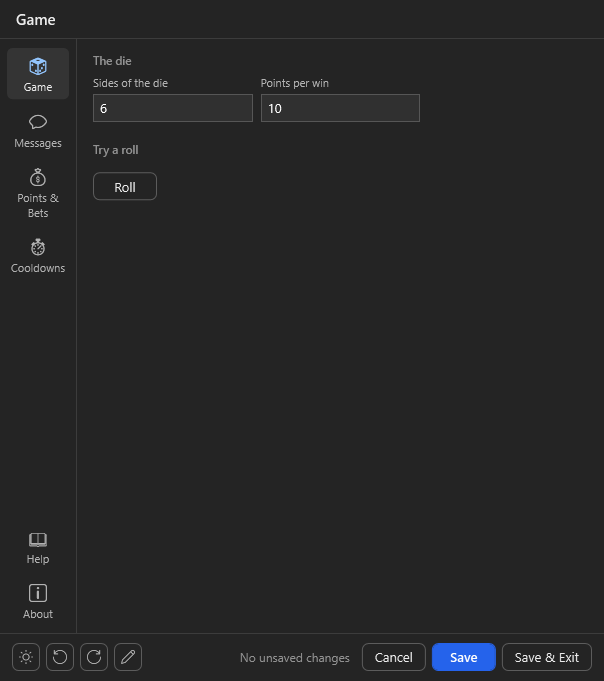
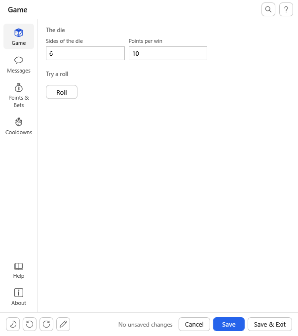
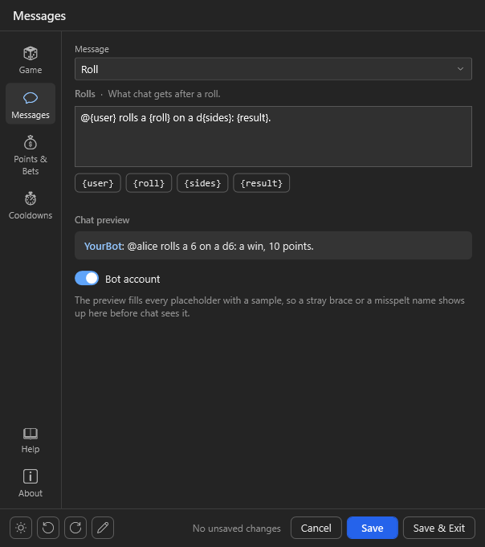

# Getting started

By the end of this page the **Demo Game** runs in your Streamer.bot: `!roll` in chat rolls a die, and a settings
window with pages, a Try button, a chat preview and a customise mode sets it up. The code comes in ready files to
paste, and nothing in them needs changing. Turning the demo into your own project comes after that, in
[Make it your own](#make-it-your-own).

| Step | In Streamer.bot | File to paste |
|------|-----------------|---------------|
| [1](#step-1-the-game-action-demo-game) | Action **Demo Game** | [`examples/DemoGame/DemoGame.cs`](../examples/DemoGame/DemoGame.cs) |
| [2](#step-2-the-command-roll) | Command `!roll` | – |
| [3](#step-3-the-settings-action-demo-game-settings) | Action **Demo Game Settings** | [`stub/Stub.cs`](../stub/Stub.cs) |
| [4](#step-4-open-the-window) | Open the window | – |
| [5](#step-5-play) | `!roll` in chat | – |

> **In a hurry?** Use *Import* in Streamer.bot and drop in
> [`examples/DemoGame/DemoGame.sb`](../examples/DemoGame/DemoGame.sb): that is steps 1 to 3 in one go. The
> settings action is called **.Demo GUI** there, the command **Run DemoGame**. The command arrives switched off,
> so tick *Enabled* on it in *Commands*, then go on with [step 4](#step-4-open-the-window).

**How to copy a file:** open its *raw* link (in each step below) and press <kbd>Ctrl</kbd>+<kbd>A</kbd>,
<kbd>Ctrl</kbd>+<kbd>C</kbd>. On a file's GitHub page, the *Copy raw file* button at the top right does the same.
Always copy the **whole** file; part of it gives compile errors.

## Step 1: the game action `Demo Game`

File: [`examples/DemoGame/DemoGame.cs`](../examples/DemoGame/DemoGame.cs) ·
[raw](https://raw.githubusercontent.com/aaskjer/UIFramework-Streamer.bot/main/examples/DemoGame/DemoGame.cs)

1. *Actions* tab, right-click into the list of actions, *Add*. Name: `Demo Game`, exactly so, since the settings
   action finds the game by this name.
2. Select the new action. Under *Sub-Actions*: right-click, *Add* → *Core* → *C#* → *Execute C# Code*.
3. In the code window, select all and delete it (Streamer.bot's template), then paste `DemoGame.cs`. Type
   `Demo Game` into the window's *Name* field too: the sub-action is then listed as "Execute Code (Demo Game)",
   which is how another action finds this code for an *Execute C# Method*.
4. *Compile*: the log under the code reports no errors. Then *Save and Compile*.

Nothing to add under *References*. The file is the whole game: the UIFramework host block (the settings and the
window, declared once) right below the `using` lines, and the game itself in the `CPHInline` class at the end.

## Step 2: the command `!roll`

1. *Commands* tab, right-click, *Add*. Name: `Demo roll`, command: `!roll`, *Enabled* ticked. *OK*.
2. Back on *Actions*, select **Demo Game**. Under *Triggers*: right-click, *Add* → *Core* → *Commands* →
   *Command Triggered*, and pick `Demo roll`.

Leave the command's cooldowns as they are. The settings window sets them from its own settings after every save
(10 seconds for everyone, 30 per viewer to begin with).

## Step 3: the settings action `Demo Game Settings`

File: [`stub/Stub.cs`](../stub/Stub.cs) ·
[raw](https://raw.githubusercontent.com/aaskjer/UIFramework-Streamer.bot/main/stub/Stub.cs)

1. *Actions*, *Add*. Name: `Demo Game Settings` (any name works here).
2. *Sub-Actions*: *Add* → *Core* → *C#* → *Execute C# Code*, select all, delete, paste `Stub.cs`.
   Change nothing: its line `private const string GameActionName = "Demo Game";` already names the action from
   step 1.
3. *Compile*, then *Save and Compile*. Nothing to add under *References*.
4. Give it a trigger that only you use, since it opens a window on your PC: a hotkey, a Stream Deck button, or a
   command (as in step 2) that only the broadcaster may run.

## Step 4: open the window

Fire the trigger from step 3. Without a hotkey or a deck at hand, right-click the trigger under *Triggers* and
pick *Test Trigger*.

- **The first time,** a question comes up: download `UIFramework.dll` into `<Streamer.bot>\UIFramework\lib\<version>\`?
  *Yes*. The file is checked against its published SHA-256 before it is used.
- **The window opens with a tour** that rings one part after the other and says what it does: the pages, a
  setting, the *Roll* button that tries a roll without sending anything to chat, the *Messages* page with its
  placeholder chips and chat preview, saving, resetting, the theme and the customise mode. *Next* goes on, Esc
  ends it. It starts by itself only this once; the **?** at the top right shows it again. Your own project gets
  one with `.Tour(...)` in its window ([Schema.md](Schema.md#the-tour)).
- Change a value and save. The window writes `<Streamer.bot>\Demo Game\DemoGame-Settings.json` and sets the
  cooldowns of `!roll`.

<p align="center">
  
</p>

<p align="center">
  
  
  
</p>
<p align="center"><sub>The demo game's window: its own page in both themes, and the Messages page the framework adds.</sub></p>

## Step 5: play

Type `!roll` in your chat. The answer reads like `@you rolls a 4 on a d6: no luck.` The highest side wins the
points per win, paid into the viewer's points: Currency Core's or LOYALTY POINTS' when one is installed, else the
user variable `points`.

### When something does not work

| You see | It is |
|---------|-------|
| Compile errors such as `The name 'UiHost' does not exist in the current context` | Only part of the file was pasted. Paste the whole `DemoGame.cs` (step 1). |
| A dialog *The settings window cannot open*, saying there is no action named 'Demo Game' | The game action is not named exactly `Demo Game` (step 1). |
| The same dialog: *The action 'Demo Game' did not run. Is it enabled?* | The game action is disabled. |
| The same dialog: *The action 'Demo Game' ran but did not answer with its settings* | Its sub-action did not compile, or is switched off. The dialog says what to look for in Streamer.bot's *Log* tab. |
| Neither the window nor any dialog comes up | The settings action did not run: check its trigger, and the log. |
| `!roll` gets no answer | The command is off, or not the trigger of **Demo Game** (step 2). A roll inside the cooldown is ignored too. |

## Make it your own

The demo becomes your own project in `DemoGame.cs` (save it under your project's name) and one line of `Stub.cs`:

1. **Names.** In `CPHInline`: `ActionName` (your action's name; the log lines carry it), `SettingsFile`,
   `CurrentVersion`, and the short host id `"demo"` in the `UiHost.Handle` and `UiUpdateNotice.Startup` calls. In
   the settings action: `GameActionName`, the same name as `ActionName`.

   | Name | Where | What it is for |
   |------|-------|----------------|
   | `GameActionName` | the settings action (`Stub.cs`), its one line to fill in | the action the settings action runs to ask your project; it must be that action's exact name in Streamer.bot. Also the prefix of the settings' log lines, `[<name>/Settings]` |
   | `GameActionId` | the settings action (`Stub.cs`), the line below it; optional | your action's id in Streamer.bot (a GUID; every run gets it as the argument `actionId`, and an export carries it). With it the settings action finds your action by the id and runs it by the id, so the settings still open after a streamer renamed the action; an import keeps the id. Left empty, or where no action has that id (an action made by hand), the action is found by `GameActionName`, and the log says so once (stub 0.3.3) |
   | `ActionName` | your action, passed to `UiHost.Handle` and `UiUpdateNotice.Startup` | the prefix of your action's own log lines, `[<name>]`. `null` in `UiHost.Handle` takes the name Streamer.bot gives the run |
   | the host id (`"demo"`) | `UiHost.Handle`, `UiUpdateNotice.Startup` | a short name for the framework's files and the update notice; it never shows |
   | `SettingsFile` | your action | where the settings live, relative to the Streamer.bot folder; the layout file sits beside it |
   | `CurrentVersion` | your action | your project's version: the About page shows it, the update check compares it |
   | the window's title | `new UiWindow("Demo Game", …)` | the window's title bar and the About page's heading |
   | `logPrefix` | `new UiWindow(…, logPrefix: "[Demo]")`, optional | another prefix for the settings' log lines than `[<GameActionName>/Settings]` |
2. **Settings,** in the `Table` near the top of the host block: one line per setting your action reads. The
   demo's, shortened:

   ```csharp
   public static readonly Setting[] Table =
   {
       S("useBot", true),
       S("globalCooldown", 10),
       S("userCooldown", 30),
       S("sides", 6, page: "game", label: "Sides of the die", help: "The highest one wins.", section: "The die", min: 2, max: 100),
       S("tryRoll", null, page: "game", label: "Roll", kind: "action", section: "Try a roll", live: true, panel: true),
       Msg("Rolls", "msgRoll", "@{user} rolls a {roll}: {result}.", "Roll", "What chat gets.", new[] { "user", "roll", "result" }),
   };
   ```

   Keys the framework knows (`useBot`, `globalCooldown`, `userCooldown`, `blockedUsers`, ... see
   [`conventions/keys.json`](../conventions/keys.json)) need only their default; label, help, page and limits
   come with them. `S(key, default, ...)` takes everything else as named arguments, and `Msg(...)` is a chat
   message with placeholders. [Schema.md](Schema.md) lists every argument and kind (numbers, switches, dropdowns,
   sliders, colours, paths, emotes, lists with a row editor, buttons that ask your action something).
3. **The window,** in `Window` just above the table, as much or as little as you like. The demo's, shortened,
   with a repository and credits of your own:

   ```csharp
   public static readonly UiWindow Window = new UiWindow("Demo Game", releases: "you/your-repo")
       .Pages(P("game", "Game", "dice"), "messages", "help", "about")
       .Cooldowns(C("!roll", "globalCooldown", "userCooldown"))
       .Help(H("Playing", Cmd("!roll", "Rolls the die once.")))
       .About(credits: "By you.");
   ```

   `releases` is your GitHub repository. It gives the About page its links, the window its check for a new
   version of your project, and your project a place in the update notice once per Streamer.bot start (`Init()`,
   see [Schema.md](Schema.md#update-notice)). `Cooldowns` is how the cooldown settings reach the command: after
   every save, the settings action sets its global and per-user cooldown from those two keys. Without it they are
   just numbers in the file. Name the command by its text (`"!roll"`), its name, or its id (right-click the
   command in Streamer.bot to copy it). For a project you ship, the id is the safer choice: an export and import
   keep it, and it still holds when a streamer renames the command.
4. **Your code,** in `CPHInline`: read the settings with `UiSettings.Load(SettingsFile, CPH.LogWarn)`, then
   `s.Int("sides")`, `s.Bool("useBot")`, `s.String("msgRoll")`. A damaged file gives the backup of the last save,
   and the log says so.

### A game you already have

1. Paste the host block from [`stub/HostSchema.cs`](../stub/HostSchema.cs)
   ([raw](https://raw.githubusercontent.com/aaskjer/UIFramework-Streamer.bot/main/stub/HostSchema.cs)), from
   `// --- UIFramework host block` to `// --- end UIFramework host block ---`, into your action **right below
   its `using` lines**, as in `DemoGame.cs` and every game on UIFramework. It needs no usings of its own and no
   reference beyond Newtonsoft.Json, which every action has, so anywhere after the usings works as well (at the
   end, or inside the `CPHInline` class). It is not an action of its own: pasted alone into an Execute Code, it
   does nothing.
2. Fill in its `Window` (`// __WINDOW__`) and `Table` (`// __TABLE__`) as above.
3. Three constants in `CPHInline`, then, first thing in `Execute()`, the call that answers the window:

   ```csharp
   private const string ActionName = "My Game";                          // your game action's name
   private const string SettingsFile = "Chat Games/My Game/settings.json"; // relative to the Streamer.bot folder
   private const string CurrentVersion = "v1.0.0";

   public bool Execute()
   {
       if (UiHost.Handle(args, CPH, ActionName, "mygame", CurrentVersion, SettingsFile))
           return true;
       var s = UiSettings.Load(SettingsFile, CPH.LogWarn);
       // ... the game, reading s.Int("..."), s.Bool("..."), s.String("...")
   }
   ```

4. For the update notice once per Streamer.bot start ([Schema.md](Schema.md#update-notice)), in `CPHInline`:

   ```csharp
   public void Init()
   {
       UiUpdateNotice.Startup(CPH, ActionName, "mygame", CurrentVersion, SettingsFile);
   }
   ```

   and tick *Precompile on Application Start* on your action's Execute Code sub-action (right-click it).
5. The settings action as in [step 3](#step-3-the-settings-action-demo-game-settings), with your action's name in
   `GameActionName`.

## Good to know

### The game action and the window

**Keep the code your action's last sub-action**, with nothing before it that acts. The window runs the whole
action for each of its requests, and a sub-action after the code still runs once `Handle` has answered and the
code returned `true`. A chat message or a sound there would go out every time the window asks something.

`UiHost.Handle` takes optional delegates, the ways the window talks to your action: `test` answers a Try button
or a field that asks on every change (`ask`), `validate` checks before a save, `saved` runs after one, and `table`
and `emotes` fill special fields. A project with plain settings passes none. The demo's Try button:

```csharp
if (UiHost.Handle(args, CPH, ActionName, "demo", CurrentVersion, SettingsFile,
        test: (name, s) => name == "tryRoll" ? Roll(s, UiCurrency.Detect(CPH, s), "alice", null) : null))
    return true;
```

**The window waits five seconds for an answer.** The settings action runs your action with
`CPH.RunAction(..., true)` and waits; a request it has given up on is skipped, not run late. One that has started
gets 30 seconds more, after which the window stops waiting and goes on without its answer. A handler that takes
long on purpose (an import) calls `UiHost.StillWorking()` every few seconds, and each call gives it 30 seconds
from then (stub 0.3.2 and on). The window stays usable meanwhile: a Try button is greyed until its answer is
there, and the check before a save keeps the input away. An answer that never came reads "the extension did not
answer", not "done". So inside `test`, `validate`, `saved`, `table` and `emotes`:

- Do not call `CPH.RunAction(other, true)` on an action that sits in the same **blocking** action queue as the
  settings action or your action. It cannot start until they end, which is after the 30 seconds a started request
  gets, and the window is left without an answer (a save asks whether to save unchecked). Run such work with
  `CPH.RunAction(other, false)`, or keep your action and the settings action out of blocking queues.
- Keep it short: no `CPH.Wait`, no web requests. Work that takes long goes into `saved` with `RunAction(..., false)`
  or into your action's own run.
- An action you run from there runs as usual: the host block clears the window's arguments (`uiframework.request`
  and the others) before your handler runs. A host block older than UIFramework 1.2.0 does not;
  [Loader.md](Loader.md) has the line to add then.

### Settings that were Set Arguments

A project that was set up with Set Argument sub-actions keeps them working. Read the settings with
`UiSettings.Load(SettingsFile, CPH.LogWarn).With(args)` and pass `arguments: true` to `UiHost.Handle`:

```csharp
if (UiHost.Handle(args, CPH, ActionName, "myproject", CurrentVersion, SettingsFile, arguments: true))
    return true;
var s = UiSettings.Load(SettingsFile, CPH.LogWarn).With(args);
```

A Set Argument named like a setting, or like one of its old keys (`aliases`), then wins over the file, and the
window shows that setting with a *Set Argument* pill and the argument's name instead of a field. Whoever only
pastes the new code keeps their values, and a value can still differ per action (a dry run for one of three).
[Schema.md](Schema.md#the-games-side) says how a value is read and which arguments count.

An import replaces an action together with its sub-actions, so a Set Argument the user changed is back at its
shipped value after every update. A value that should last belongs in the settings file, which no import touches;
a Set Argument is for the exception.

The version that moves the values into the file takes the old ones along once. Name the action the earlier
version kept them in, and the window shows them as unsaved changes the first time it opens, read from
Streamer.bot's actions or from its last backups:

```csharp
public static readonly UiWindow Window = new UiWindow("My Project")
    .Adopt(Old("5d80b7e4-2c19-4a63-8f05-e1b6a3d92c47", "sendAsMe>sendAction"));
```

An argument named like a setting needs no mapping; `"old>new"` leads one of another name to its setting.
[Schema.md](Schema.md#values-from-the-version-before) has the rest: Send Message texts, where it looks, what it
leaves out.

### A project with several actions

One action answers the window, the others only read the settings.

- **The host action** carries the host block with the table and calls `UiHost.Handle`. Where the working actions
  run all the time, or may be deleted one by one, make it an action of its own that does nothing else
  (`My Project Settings Host`). The settings action names it in `GameActionName`.
- **Every other action** carries the host reader instead of the host block:
  [`stub/HostReader.cs`](../stub/HostReader.cs), from `// --- UIFramework host reader` to
  `// --- end UIFramework host reader ---`, right below its `using` lines. It knows no table, so each call names
  what holds while the file has no value:

  ```csharp
  var s = UiSettings.Load("My Project/settings.json", CPH.LogWarn).With(args, "dryRun");
  string url = s.String("webhookUrl");
  int perHour = s.Int("postsPerHour", 6);
  bool dryRun = s.Bool("dryRun");
  ```

  `With(args, keys…)` lets a Set Argument of a named key win over the file, for a value that differs per action.
  `tools\update-host-block.ps1 -File … -Reader` refreshes the reader, as it refreshes the host block.
- **Do not rename a key** once readers exist. The window writes the new name back with the first save, and a
  reader would go on looking for the old one. `aliases` are for a project whose every action carries the table.
- **Work that takes long** (a web request, a download, a check run) does not go into a `test` handler. Start the
  working action with `CPH.RunAction(name, false)` and answer that it has started.
- **`UiHost.Handle` comes before any lock, run check or timer** of the host action. The window's request has to
  be answered also while the action's own work is under way.

### Points

A game that pays out declares `S("pointsVariable", "points")` and `S("pointsName", "Points")` and asks
`UiCurrency.Detect(CPH, settings)` on every run. When the streamer runs StreamUP's Currency Core or Tawmae's
LOYALTY POINTS, `Variable` and `Name` come from there and the window shows a pill saying so; otherwise the two
settings apply. The demo pays a win into that variable with `CPH.GetTwitchUserVarById`/`SetTwitchUserVarById`
(YouTube and Kick likewise).

### What you get without writing it

- Pages from the table, sections where `section` changes, numbers three to a line, switches two.
- Validation: limits, a `requires` that greys a field out, your `validate` answer before a save.
- A Messages page with placeholder chips and a live preview, sender switches, a cooldown group.
- A Log page that follows your log folder as your project writes it (`.Log(folder, files)` in the window).
- Reset to defaults, per page or all; unsaved-change tracking; dark and light theme; an accent colour.
- The customise mode: users rename, move and hide fields and pages. Their changes go into
  `uiframework.layout.json` next to the settings file and survive every import of your extension
  ([Customize.md](Customize.md)).
- Export and import of the settings.
- A red **i** in the header when the table or the window declares something the framework cannot use (an unknown
  kind, a requirement on a key that is not there) or something fails while the window is open. A click lists it
  all, with a *Copy* button for a bug report, so you see it without reading Streamer.bot's log. The pages stay clean.

### What your users get on their machine

This is what to tell a streamer who imports your extension, or link them here:

- **First open:** the settings action asks whether to download `UIFramework.dll` from this repository's
  release into `<Streamer.bot>\UIFramework\lib\<version>\` (for example `lib\1.2.0\UIFramework.dll`). The file is
  checked against its published SHA-256 before it is used. *No* opens the `lib` folder so they can put the DLL
  there themselves, in a folder named after its version; *Cancel* leaves everything as it is.
- **Updates:** when a newer framework release is out, the window asks before it downloads anything. *No* skips
  that version for every extension, and the update notice at the start no longer names it. *Cancel* (or closing
  the dialog) means "not now" and shows the version as a pill in the window's header until it is taken.
- **Turning the update check off:** `{ "autoUpdate": false }` in `<Streamer.bot>\UIFramework\loader.json` turns it
  off for every extension, and the update notice at the start then leaves UIFramework's releases out. For one
  extension alone, `"autoUpdate": false` goes into its `uiframework.layout.json`, the file next to its settings
  file (`settingsFile`, relative to the Streamer.bot folder). The window then opens with the DLL it has and asks
  nothing.
- **Without the window:** your action needs the DLL for two things only, the update notice at the start and the
  live check (`UiLive`), and does without both when it is not there. With the settings action disabled, your
  project keeps working with its settings file, which can still be edited by hand.

[Loader.md](Loader.md) has the details: where `latest.json` comes from, the hash on every load, what happens
offline.

### Keeping up

The host block is the same in every project. When a new framework release changes it, run

```powershell
tools\update-host-block.ps1 -File "C:\...\YourGame.cs"
```

which swaps the block and keeps your Window and Table. Before it writes, it saves a copy of the file as `.bak`.
It refuses, and writes nothing, when the old block holds lines of yours outside the Window and the Table, which
the swap would drop, or when the Table's end cannot be told for sure. `-Force` writes anyway; `-Check` only tells
whether the block is current. The settings action never changes per project; replace it with the new
`stub/Stub.cs` when a release says so.
