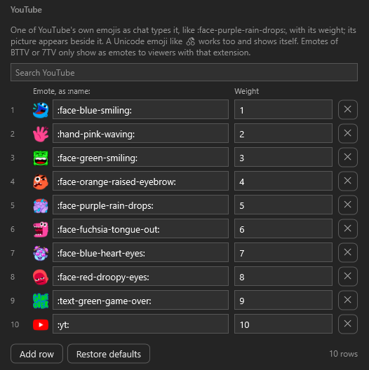
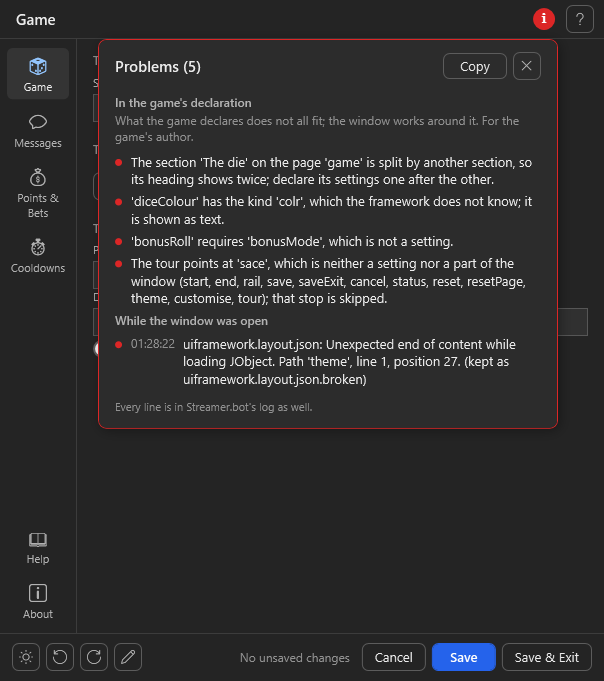

# Schema: what a game declares

The schema is everything the settings window needs to know about a project: the settings it reads, and the window
they are shown in. Your action holds both in its host block (`stub/HostSchema.cs`, pasted into the action), reads
its values through the same table, and answers the window's `describe` request with the whole thing as JSON.
Values never sit in the schema, only in the settings file.

```json
{
  "host": "blackjack",
  "version": "v17.0.0",
  "settingsFile": "Chat Games/Blackjack Game/BJG-Settings.json",
  "settings": [ { "key": "...", "default": ..., "kind": "...", ... } ],
  "window": { "title": "Blackjack Game", "pages": [ ... ], "help": [ ... ], ... }
}
```

The host block builds this from two declarations:

```csharp
public static readonly UiWindow Window = new UiWindow("Blackjack Game", releases: "aaskjer/Blackjack-Game")
    .Pages(P("table", "Table", "cards"), P("stats", "Stats", "trophy", "leaderboard*", "resetLeaderboard"), "messages", "log", "help", "about")
    .Log("Chat Games/Logs", "BJG-log*.txt", writeLogKey: "logToFile")
    .Help(H("Playing a hand", Cmd("!blackjack <bet>", "Deals you in."), "A hand ends when everyone stands or busts."));

public static readonly Setting[] Table =
{
    S("useBot", true),
    S("globalCooldown", 10),
    S("maxBet", 1000, page: "table", min: 1, help: "Per hand and player."),
    Msg("Wins", "msgWin", "@{user} wins {amount} {pointsName}!", "Win", "Sent when a hand wins.", new[] { "user", "amount", "pointsName" }),
};
```

Keys the conventions know (`conventions/keys.json`: `useBot`, `globalCooldown`, `blockedUsers`, ...) need nothing
but their default; label, help, kind, page and limits come from the conventions. Everything else says what the
conventions cannot know.

## A setting

| Field          | Required | Meaning                                                                                   |
|----------------|----------|-------------------------------------------------------------------------------------------|
| `key`          | yes      | camelCase; canonical for keys the conventions know, free otherwise                          |
| `default`      | yes      | a JSON value; without `kind` it decides the kind                                            |
| `kind`         | no       | one of the kinds below; derived from `default` when missing                                 |
| `page`         | no       | the page's id; the conventions or the window set it otherwise, the rest lands on `game`     |
| `label`        | no       | shown above the field; known keys take it from the conventions                              |
| `help`         | no       | one sentence, the field's tooltip; a line under the field once the user turns on *Help under fields* (customise bar, or the bulb of a locked window) |
| `min`, `max`   | no       | for `int`, `long`, `double`, `duration`, `percent`: a number outside is saved as the nearest limit, and the field then shows that value; a `min` below 0 lets a whole-number field take a minus |
| `step`         | no       | the step of a `slider` over a range                                                          |
| `unit`         | no       | in brackets behind the label (`s`, `%`, `px`); a slider shows it after its value, and a `percent` always says `%` |
| `options`      | no       | the choices of `options` or a `slider`: `["a", "b"]`, with labels `[{ "value": "a", "label": "Label A" }]`; the host block's short form `"a|Label A"` is read from a schema written by hand too |
| `optionsFrom`  | no       | for a dropdown whose options the project names (`options:` in `UiHost.Handle`): the key of the field they depend on. The project is asked when the pages are built and again shortly after that field changes, with the values as they stand in the window (the regions of the country picked). `"groups"` offers Streamer.bot's groups without asking the project; `""` asks once. Options the setting declares itself show until the answer is there, and stay when the project names none. The stored value and the default are never lost: where no option has them they are entries of their own, and such a dropdown never picks an option by itself. A pick the new options lack goes back to the stored value |
| `placeholders` | no       | for `template`: the names without braces, shown as chips                                    |
| `placeholderStyle` | no   | for `template`: `percent` for a message whose text writes `%user%` where the others write `{user}`. Its chips insert the placeholders so, the preview fills them, and the check of the default text looks for them. For every message at once it goes on the window (`placeholderStyle:` on `UiWindow`); a message that says `braces` keeps `{user}` there (host block: `placeholderStyle:` on `Msg()`) |
| `section`      | no       | a heading; where it changes, a new section of the page begins                               |
| `group`        | no       | for `template`: the group in the message picker (host block: `group:` on `S()` as well as `Msg()`) |
| `factor`       | no       | for `percent`: stored = typed × factor (0.01 stores a fraction; default 1)                  |
| `unlimitedAtZero` | no    | for `int`, `long` and `duration`: 0 in the field means "no limit" and is stored as MaxValue |
| `aliases`      | no       | old keys: the store reads them and writes the canonical key back. An alias with a dot (`PlatformEmotes.twitch`) takes the value out of an object of the old file; the object goes once it is empty, and the old value goes from it also when the file has the canonical key already. Two settings naming the same alias (one old switch that became two) both take its value, a dotted one too. An alias that is another setting's key is not moved (the check names it) |
| `aliasFactor`  | no       | multiplies the first alias's value on the move (a fraction to percent: 100). The host block writes it as `"aliasFactors": { "OldKey": 100 }`, which can give every old key its own factor; both are read |
| `hidden`       | no       | true: no field, but the value stays in the file; the user can show it in the customise mode unless the window is locked |
| `confirm`      | no       | for `action`: a yes/no question before the project is asked                                 |
| `row`          | no       | the name of a row: settings that name the same row one after the other share one line of the page, whatever their kind (a bet, a role and a Try button; a button takes the width it needs, an answer `panel` goes under the row); without it numbers sit three to a line, switches two, everything else alone |
| `requires`     | no       | a `bool`'s key, or a condition on any field (`numberOfSlots>=5`, `cpBetMode=fixed`, `mode!=free`; `=`, `!=`, `<`, `<=`, `>`, `>=`): the field is greyed out while it does not hold. To hide it instead, use `showWhen` (a section heading whose fields are all hidden hides with them). `hide:` in front of a `requires` did the same before there was a `showWhen`; it is no longer read, the field then always shows, and the red **i** names the `showWhen` to write. `!key` holds while a switch is off or a field (or a list) is empty. A key the window does not show (hidden by the user) is read from its saved value. A condition compares the value as it is stored, shown or not: a `percent` as the number, or as the fraction where `factor` is 0.01 (`reshuffleThreshold>=0.5` for 50 %), a `duration` in seconds, an "unlimited" 0 as the large number it is saved as. `<`, `<=`, `>`, `>=` need a number on both sides; the check names one that compares text |
| `showWhen`     | no       | the field is shown only while the condition holds, whatever its kind (a field, a switch, a note, a button, a list): `questionSource=igdb`; several values, one of which must be picked, `questionSource=opentdb|wikidata`; none of them, `questionSource!=custom|igdb`; several conditions that must all hold, `mixOwn && questionSource!=custom`; a switch that is off, `!useBot`. `requires` still greys out; both can be set |
| `shows`        | no       | on a dropdown: per option value the keys of the fields that option shows, `{ "igdb": ["igdbClientId", "igdbClientSecret"], "opentdb": ["cacheSize"] }` (host block: `shows: new[] { "igdb: igdbClientId, igdbClientSecret", "opentdb: cacheSize" }`). A field named by several options shows with any of them; a field with a `showWhen` of its own needs both |
| `masked`       | no       | true: a text field shown as dots, with an eye button that reveals it (a token, a client secret); the value is saved like any other |
| `hint`         | no       | for a one-line text field, masked or not: grey text inside the field while it is empty (`not set`, `optional`). `Tx` translates it |
| `global`       | no       | the name of a persisted global of Streamer.bot that holds this value instead of the settings file (a token another action reads from there). The settings action reads it when the window opens and writes it after a save; the value is never in the file, an export or the log, and a reset leaves it. Needs stub 0.3.3; see *A secret in a global* under *The game's side* |
| `readOnly`     | no       | true: shown, not editable (a status the project writes); `readonly` is read too (host block: `readOnly:` on `S()`) |
| `followsAction` | no      | on a switch: the name of an action of Streamer.bot the window watches (`Actions`, below). While that action is disabled or gone, the switch shows off, cannot be changed and says why in a line under it; its own value is kept, is what a save writes, and shows again once the action is back. See *Actions of Streamer.bot* below |
| `setsAction`   | no       | on a switch: the name of a watched action the switch stands for. It shows whether the action is enabled and enables or disables it in Streamer.bot at once, with the click; it holds no value, is never saved and is no change. While the action is gone it cannot be used and says so |
| `twitchOnly`   | no       | a switch carries a "Twitch only" pill; any other field with a label says "(Twitch only)" in it (a reward's id, a button)                                         |
| `transient`    | no       | true: shown, never saved, never counted as a change; only a live snapshot for the project carries it (the inputs of a Try button) |
| `live`         | no       | for `action`: the project gets the values as they stand in the window, unsaved and transient ones included |
| `ask`          | no       | on a field that is no button: the project is asked whenever the field changes (`test` with the field's key and the live values), and `set` in its answer fills other fields (a preset slider that sets five numbers). `live` on such a field meant the same before `ask` had a name and is still read. UIFramework 1.9.0 hands `ask` alone the saved values and the live ones only with `live` beside it; the host block writes `live` beside `ask`, so a 1.9.0 window asks with the live values too |
| `panel`        | no       | for `action`: the answer is shown in a box under the button instead of the footer; its `status` still goes to the footer |
| `auto`         | no       | for `action`: no button; the project is asked when the page is shown and shortly after every change in the window (odds that follow the settings). It always gets the values as they stand in the window and has its own box: `live` and `panel` come with it |
| `every`        | no       | for an `auto` action: asked again every so many seconds while its box is on the page in front (a status). 5 at least; a lower number is taken as 5 and named behind the red **i**. Another page, a hidden box and a closed window stop it; coming back asks at once |
| `saveFirst`    | no       | for a button: the window's unsaved changes are saved first, exactly as *Save* would (its check and question included), and the project is asked only when that save happened. Without unsaved changes it just asks |
| `columns`      | for `list`, `table` | `"key|kind|label"` per column; kinds `string`, `text` (multi-line, double width), `int`, `long`, `double` (half as wide), `bool`, `emote` (a text field with the picture beside it; a fourth part `|twitch`, `|youtube` or `|kick` says where the picture comes from: Kick from `[emote:ID:name]` or the short `ID:name`, Twitch by name from Twitch/7TV/BTTV/FFZ with what the project's `emotes` answer lists, YouTube's own emojis by their `:name:` from a table inside the DLL, a Unicode emoji shows itself). A trailing `|readonly` (`readOnly: true` in JSON) makes a column the project fills and the user only reads; a flag right after the kind (`"wins|int|readonly"`, `"face|emote|twitch"`) leaves the key as the header. A number column takes only a number: anything else puts the cell back to what it held. From eight rows a list gets a search box that hides the rows the text does not occur in |
| `rowKey`       | no       | for a `list` the project writes to as well: the columns that together name a row, `"Date,Name"`. A save then merges, by that key, what the window loaded, what it holds now and what the file holds at that moment: a row the project added meanwhile stays, a cell the user changed wins, a row the user removed goes. See *A list the project fills* under *The game's side* |
| `fixedRows`    | no       | for a `list`: rows are neither added nor removed in the window, only their cells edited; there is no *Restore defaults*, and a reset leaves the list alone |
| `rowNumbers`   | no       | for a `list` shown as a table: `false` leaves out the first column, which counts the rows as they are shown (1, 2, 3 …). For rows that carry a number of their own in a column (a note's number, a rank), which would otherwise show two columns of numbers. Nothing else changes; a list in the row editor has no such column |
| `fitWidth`     | no       | for a `list` shown as a table and for a `table`: how the table meets its width. `true` keeps the columns within it: no horizontal scrollbar, a text too long for its column ends in an ellipsis, and a column the user drags wider takes its room from the others instead of pushing them past the table's edge. `false` lets the columns run past it: each as wide as its contents, under a horizontal scrollbar. Left out, a `list` is kept within and a `table` runs past, as both did before there was the choice. The two log pages take the same word from the window (`Log`, `StreamerBotLog`) |
| `filter`       | no       | for a `list`: the rows shown, conditions joined by `\|\|`: `region= \|\| Global=true \|\| Counties~{region}`. The left side is a column of the list (in its exact spelling), else a setting of the window; `{key}` is a setting's current value. `=` and `!=` compare as text ignoring case, `~` is "contains" (for an array in the cell: one element equals it). A row that does not fit is hidden, not removed: it is saved back as it was |
| `format`       | no       | for a `list` of two columns: `pairs` stores it as one line of text, `a:b,c:d`, where a list is otherwise an array of rows. For a project that has always read its pairs so (a name and its points, a word and its answer). The window still shows rows to edit. Reading is generous: entries stand between commas, semicolons or lines, and the first `:` or `=` parts a key from its value; a key alone has an empty value. Writing is strict: `key:value` between commas. The text has no escaping, so a key's cell does not take `: = , ;` and a value's cell does not take `, ;`. The columns are `string`, `int`, `long` or `double`; the default is that text, or rows. The project gets the text in every request, and `UiSettings.Pairs(key)` reads it. A `rowKey` does nothing here: the line is written whole |
| `rowsFrom`     | no       | for a `list` the project keeps itself (notes in a file per category that its chat commands write, rows in a database): the key of the field its rows depend on, `""` for none. The window neither reads nor writes such a list. It asks the project for the rows (`rows:` in `UiHost.Handle`) when the pages are built and again shortly after that field changes, shows them to edit, counts an edit as an unsaved change, and on Save hands the project the rows as they are, with the rows it was given (`saveRows:`); the project answers the rows as it keeps them. While the list has unsaved changes, the field it depends on does not move on: it goes back, and the footer says to save or undo first. Nothing of the list is in the settings file, an export or a reset, and a default it declares is not shown. Rows the project does not take stay unsaved, with the reason behind the red **i**. See *A list the project keeps* under *The game's side* |
| `file`         | no       | a file next to the settings file that holds this value instead (a word bank, a question list); relative or absolute |
| `field`        | no       | with `file`: the property in that file that holds the value; without it the file itself is the value |
| `platform`     | no       | for `emote`: `twitch`, `youtube` or `kick`, where the picture comes from                     |

Without `kind`: bool → `bool`, whole number → `int` (`long` when it does not fit an int, also where the conventions
say `int`), decimal → `double`, string → `string`, array → `list` (which then needs `columns`).

A value in the settings file that does not fit its field never stops the window from opening: a number field or a
slider over a range whose value is no number (`""`, `"abc"`) shows its default, a number stored as text is read
(`"0,5"` is 0.5, from a German Windows), and a whole-number field holding a fraction shows it as it is, so the check
before saving names it instead of cutting it. A `null` stands for the setting's default (or an old key's value), as
it does for `UiSettings` in the host block, and the next save writes that in its place. A dropdown or a slider over
stops whose stored value none of its options has keeps it as an extra entry (the slider names it beside its label)
and saves it back unchanged until the user picks another. The slider finds a number's stop by its value: a stored 2
is the stop `"2.0"`. Numbers are written and compared with a point whatever the system's language.

A list's `columns` are objects in the schema, `{ "key": "word", "kind": "text", "label": "Word", "readOnly": true,
"platform": "kick" }`; the host block's `"word|text|Word|readonly"` is read from a schema written by hand too. So is
`shows` as the host block takes it, `["igdb: igdbClientId, igdbClientSecret"]`.

What the red **i** names in a declaration, beyond a key or an option that does not exist: `panel`, `auto` or
`confirm` on a field that is no button; `placeholders` on one that is no message; a `platform` other than twitch,
youtube or kick; a `{placeholder}` in a message's default text that its `placeholders` do not list (a
`%placeholder%` in the percent style); a `placeholderStyle` that is neither `braces` nor `percent`, or one on a field
that is no message; a field the project locks that is no setting; `every` on anything but an `auto` action,
`saveFirst` on anything but a button; a `hint` on anything but a one-line text field; a `country` whose default is
neither a code nor empty, or which offers a code that is none; a state of a header pill whose condition names no
setting, or whose tone is none; another title for a section no setting is in; a `format` on
anything but a list, one that is not `pairs`, or `pairs` on a list that has not two columns of plain values; the
page `sblog` named without a Streamer.bot log declared; `rowsFrom` on anything but a list, one that names itself or
a key that is no setting, or beside `file` or `transient`; `rowKey`, `fixedRows`, `rowNumbers` or `filter` on a field that is no list, `fitWidth` on one that is neither a list nor a table, a `rowKey`
column the list does not have, a `filter` condition without an operator or one that names what is neither a column
nor a setting (such a condition counts as holding, so every row shows); `optionsFrom` on a field that is no dropdown, one that names itself or a key
that is no setting; a `multi` without options, or whose default names a value none of them has; a
`time` with `min` or `max`, or whose default is not written `HH:mm`; a `global` on a button, a note, a table or a
list, without a name, together with `file`, or named by two settings (such a field is locked, so its value never
falls back to a file); a `requires` that is no version, or above the UIFramework that opened the window; a group of pages without an id
or a title, two with the same id, one that names a page the window does not have, a page at the foot, or a page
another group names already; `twitchOnly` on
a note; an `options` field without options, a slider with neither options nor both `min` and `max`, a slider over a
range whose default is a whole number while its `step`, `min` or `max` has a fraction (such a slider holds whole
numbers; a default written `1.0` makes one of decimals), a `list` without columns; a page the window names by its id
alone that no setting is on (`"mesages"`); a page that names a switch the Messages or the Log page draws (the switch
stays there); a `custom` page behind the generic settings action, which builds none; a `Cmd`, `Link` or `Note` where
the tour wants a `Tip`, and a `Tip` among a help section's lines (the host block hands all four as one type, so the
wrong one compiles); a style of the Log page's colours that is none; a log declared with its folder and files whose
page the window does not name (there is then no Log page, and no switch for the log). An unknown kind is told the
kinds there are. So is what an older host block could say and the window no longer reads: `overrides` in the window
(`UiWindow.Override`; page, label, help, section and `hidden` go where the setting is declared), and a window the
settings action passes itself.

## Kinds

| Kind        | Default     | Control                                    | Notes                                                 |
|-------------|-------------|--------------------------------------------|-------------------------------------------------------|
| `bool`      | bool        | toggle                                     |                                                       |
| `int`       | int         | number field; with `options` a dropdown    | `min`, `max`, `unit`, `unlimitedAtZero`                |
| `long`      | long        | number field                               | like `int`, for big balances                          |
| `double`    | double      | number field; with `options` a dropdown    | `min`, `max`; dot or comma; `1,000` and `1.000,5` are refused as ambiguous |
| `percent`   | int/double  | number field 0 to 100 with `%`             | stored as the number, not a fraction (see `factor`)   |
| `duration`  | int         | number field with a unit                   | stored in whole seconds; `unit` `min` or `h` types and shows minutes or hours (1.5 min is saved as 90), `s` or none seconds; `min`/`max` are seconds |
| `string`    | string      | one-line text field                        | saved as typed, spaces at either end included (a prefix `"🎲 "`) |
| `text`      | string      | multi-line text field                      |                                                       |
| `template`  | string      | multi-line, placeholder chips, chat preview| `placeholders`; the preview fills them with samples   |
| `options`   | string      | dropdown                                   | `options` required, unless `optionsFrom` has the project name them |
| `namelist`  | string      | chips, Enter adds one                      | stored comma-separated                                |
| `grouplist` | string      | chips with Streamer.bot's groups suggested | stored comma-separated; the groups come from the settings action (stub 0.3.2 and on), asked once when a group field first gets the cursor; Up/Down and Enter or a click add one, and a typed name goes in as typed. With an older settings action the field takes typed names only |
| `multi`     | string      | check boxes over `options`                 | several of a fixed set of choices. Stored comma-separated, the ticked values in the options' order and spelling: `"steam,gog"`, nothing ticked `""`. A stored value none of the options has stays, shown as a chip with a cross, until the user removes it. The boxes stand in columns, each as wide as the widest; a field named like the heading it stands under shows no caption of its own. `UiSettings.Values(key)` reads it as a `string[]`. Conditions: `!key` holds while nothing is stored, `key=steam` while steam is ticked, `key=steam\|gog` while one of them is, `key!=steam\|gog` while neither is. A DLL before this kind shows a text field and names the kind behind the red **i**; the value stays |
| `time`      | string      | a time of day, `HH:mm`                     | the 24-hour clock. The field takes `9`, `9:5`, `0905`, `9.05` or `21h` and writes `09:05`; text that is no time stays in the box and stops the save, as for a number. Empty is allowed only where the default is empty. `min` and `max` do nothing here. Sits three to a line with the numbers |
| `country`   | string      | dropdown over the countries                | stores the two-letter code of ISO 3166 (`DE`), or `""` for no country; Kosovo is in as `XK`. An entry reads "Germany (DE)", the list is sorted by name, and a typed letter jumps to the first country that starts with it. The names are in the window's language: the English ones are built in, another language's come from Windows (10 from 1703 on), and where it has none the English ones stand. An entry for no country comes first where the default is `""`. `options` narrow the list to the codes they name; an option with an empty value names the entry for no country (`"\|Everywhere"`), and one with a label of its own shows that in place of the country's name. A code the file holds in lower case is read, and written back in upper case; one that is no country stays as an entry of its own. A DLL before this kind shows a text field and names the kind behind the red **i**; the value stays |
| `path`      | string      | text field with a button for Windows' file or folder dialog and one that opens the folder in Explorer | relative to the Streamer.bot folder is fine; a value or default that names a file (`overlay\state.json`) gets a file dialog, and the folder button opens the folder the file is in; a choice is written as a full path |
| `colour`    | string      | colour field with a picker                 | `#rrggbb` or `#aarrggbb`; the kind `color` is read too |
| `emote`     | string      | text field with the emote's picture beside | `platform` says `twitch`, `youtube` or `kick`; Twitch's global emotes show without a Twitch login, the channel's once Streamer.bot has one |
| `slider`    | string/int/double | slider                               | with `options` a slider over the stops (the stop's value is stored, the labels sit under the stops); otherwise from `min` to `max` in `step`, the value beside the label; a default with a decimal makes it a `double` |
| `list`      | array       | row editor: a cell per column, remove, *Add row*, *Restore defaults*; with a `text` column or more than three columns a table instead, edited in place: one line per row, a click into a cell edits it, a `bool` column is a checkbox in every row, a search box above, Delete removes the picked rows | `columns` required; empty rows are dropped on save; with `file`/`field` in a file of its own; in the table a row keeps the properties no column shows |
| `table`     | array       | a table, read-only                         | for statistics the project writes; rows from its `table` answer |
| `note`      | –           | a paragraph on the page (`help`, else a text `default`) | no value; explains what follows; http(s) addresses are links, and `[words](https://…)` is a link that reads as the words |
| `action`    | –           | a button                                   | no value; asks the project (`test` with the key); the answer is the footer line, with `panel` a box under the button, with `live` from the current values, with `auto` without a button and by itself. See *Answers* below |

<p align="center"></p>
<p align="center"><sub>A <code>list</code> with an <code>emote</code> column and a number column (Slot Machine's YouTube reels).</sub></p>

### Answers of an action

The project answers `test` with a line of text, or with a JSON object:

```json
{
  "lines": [ "Jackpot every 2,400 spins.", { "text": "27 %", "big": true },
             { "emotes": ["Kappa", "LUL"], "platform": "twitch", "text": "The slots" } ],
  "bar": [ { "label": "Win", "value": 27, "text": "27 %", "colour": "#16a34a" }, { "label": "Loss", "value": 73 } ],
  "set": { "gridSize": 8, "shipCarrierEnabled": true },
  "status": "Fleet preset applied."
}
```

- `lines` are drawn one under the other in the action's box, so they need `panel` or `auto`; a line with `emotes`
  shows them as pictures with their names beneath (on YouTube a Unicode emoji shows itself, and a shortcode without
  a picture its text), after its `text` when there is one.
- A line can be a row with a label, a pill and a value, for a status:

  ```json
  { "lines": [ { "label": "Action", "pill": "Running", "tone": "ok", "text": "since 14:02" },
               { "label": "Action id", "text": "4f1c…", "copy": true },
               { "pill": "Paused", "tone": "warn" } ] }
  ```

  The parts stand in that order: `label`, `pill`, `text`, and with `copy: true` a small button that puts the text
  on the clipboard. The labels of one box share a column. `tone` is `ok` (green), `warn` (amber) or `muted` (grey,
  also for anything else). With `every` on an `auto` action the box follows what the project reports.
- `bar` is a stacked bar with a legend, in the same box.
- `set` puts values into other fields of the window as if typed (nothing is saved until Save: a preset button). A
  field whose value changes glows in the accent colour for a moment. An answer that arrives while a save waits for
  `validate` is not part of that save and stays unsaved. A `list` takes its rows as an array (or the JSON text of
  one), so an import can fill the list it merged into.
- `copy` puts one field's value into another inside the window, as if typed: `"copy": { "salesKey": "freeKey" }`,
  the field it goes to first. The project names the two fields and never sees the value, so this is the way to copy
  a secret, which reaches the project only as `""` or `"*"`. The value is the one the window holds, saved or not.
- `status` is the line for the footer, with a box or without.
- `clipboard` is text the window puts on the clipboard (an overlay URL). Your action runs on Streamer.bot's thread,
  which has no clipboard; the window's thread has one.

## The window

The window declaration says what the window is called and how it is laid out. Everything is optional. A page a setting names but the window does not is made up on the way;
`messages` appears once there are templates, `help` once there are help sections, custom triggers or methods, and
`log` only where the window names it. `help`, `log` and `about` sit together at the foot of the rail, in that order,
whatever order the window declares them in (a page of the project's own with `bottom` goes above them).

```csharp
public static readonly UiWindow Window = new UiWindow("Blackjack Game", releases: "aaskjer/Blackjack-Game", logo: "https://…/logo.png")
    .Pages(P("table", "Table", "cards"), P("stats", "Stats", "trophy", "leaderboard*", "statsTable", "resetLeaderboard"), "messages", "log", P("help", "How to play"), "about")
    .Log("Chat Games/Logs", "BJG-log*.txt", writeLogKey: "logToFile", columns: new[] { "Player|User", "Bet" }, results: new[] { "Win", "Loss", "Push" })
    .Cooldowns(C("dc2d4f17-…", "globalCooldown", "userCooldown"))
    .Pill("freeGame", "Free game on", "Free game off", tooltip: "While it is on, nobody stakes or wins anything.")
    .Senders(cooldownGroup: "Cooldown")
    .Samples("user", "alice", "bet", "1,500", "cards", "🂫(10) 🂺(10)")
    .Answer("resetLeaderboard", "The leaderboard is empty.")
    .Help(H("Playing a hand", Cmd("!blackjack <bet>", "Deals you in."), "A note.", Link("Guide", "https://…")))
    .About(credits: "Responsible: aaskjer", links: new[] { Link("Discord", "https://…") });
```

| Part                 | Meaning                                                                                              |
|----------------------|------------------------------------------------------------------------------------------------------|
| `UiWindow(title, …)` | the window title and About heading; `releases` is `owner/repo` on GitHub (repository and releases links, the update check); `logo` a URL; `logPrefix` for the framework's log lines (default `[Title/Settings]`); `width`, `height`; `placeholderStyle: "percent"` for a project whose messages write `%user%` instead of `{user}` (in the schema `"placeholderStyle": "percent"`); `requires: "2.1.0"` for the oldest UIFramework the window works with: a settings action from stub 0.3.3 on offers that update instead of opening the window with an older one, and without it the window stays closed (in the schema `"requires"`) |
| `Pages(…)`           | the pages in order: `P(id, title, icon, fields…)` or the id of a standard page (`messages`, `log`, `sblog`, `help`, `about`). `icon` is an emoji or a conventions name (`gear`, `dice`, `coins`, `clock`, `shield`, `chat`, `trophy`, `monitor`, `list`, `book`, `info`, `cards`, `chart`, `gift`). `fields` are keys or patterns like `overlay*` the page claims ahead of their own page; a pattern never takes a template off the Messages page, a full key does (it is then that page's field, not an entry of the Messages picker); a field the user moved to another page in the customise mode stays there. `P(...).AtBottom()` puts a page of the project's own at the foot of the rail, above How to play, Log and About (in the schema `"bottom": true`) |
| `InLanguage(code)`   | the window's language whatever the user's is (`"de"`): the window then offers none to pick. In the schema `"language": "de"` |
| `Log(folder, files, …)` | the Log page: the folder (relative to the Streamer.bot folder) and the files in it (`BJG-log*.txt`), which the settings action reads and the page follows as they change; `writeLogKey` the bool behind "Write a log file per day", `writeLogLabel` (another wording for that switch) and `writeLogHelp`, `columns` after Time and Result as `"Header|field"` (a field may name several keys, `"Word|Word,Word was"`: the first the line has is shown), `results` for the filter, `platforms`, `emptyText`, `styles` and `outcome` (see *The colours of the results* below). Headers and `emptyText` translate through `Tx`. The page reads lines as `[yyyy-MM-dd HH:mm:ss] RESULT \| User: name \| Platform: twitch \| Key: value \| …`, and older lines in columns (`yyyy-MM-dd HH:mm:ss RESULT  user  [R1\|id] Key: value \| …`) as well. `fitWidth: true` keeps the columns within the table's width, the last one taking what the others leave and a value too long ending in an ellipsis (the box under the list shows the whole line); without it they are as wide as their contents, under a horizontal scrollbar. In the schema `"fitWidth": true` in `log` |
| `StreamerBotLog(match…)` | Streamer.bot's own log as a page, for a project that logs with `CPH.LogInfo` and writes no file of its own: the lines of one day that hold one of the texts (`"[My Project"`, `"'My Action'"`), whatever the case; without a text, every line. Newest first, with a search, a filter by level (`ERR`, `WRN`, `INF`, `DBG`) and by source, and the day to pick from the log files there are. The source is what stands before ` :: ` in a line, or what the project puts in brackets in front of its own (`[My Project/Settings]`). Lines without a head of their own (a stack trace) go with the entry before them; the box under the list shows the whole entry. The page follows the file while Streamer.bot writes it, and holds the newest 5,000 lines of a day. It comes by itself, at the foot of the rail above About; naming `"sblog"` among the pages gives it a title or an icon of its own. The window reads the file itself, so no settings action is too old for it. In the schema `"streamerBotLog": { "match": [ … ] }`. A UIFramework before 2.3.0 shows no such page. By itself the page keeps its columns within the table's width, a line too long ending in an ellipsis; `StreamerBotLog(false, match…)` lets a line run on under a horizontal scrollbar (`StreamerBotLog(true, …)` says the first outright). In the schema `"fitWidth": false` beside `match`. A UIFramework before 2.5.0 does not read it |
| `Cooldowns(C(command, global, user), …)` | commands whose cooldowns follow settings: the settings action sets them in Streamer.bot after every save. The command by its id (right-click the command in Streamer.bot, *Copy Id*; an import keeps it, so it is the robust way), or by its text (`!roll`) or name for a command made by hand; `global` and `user` are the keys of the two durations, either may be null |
| `Pill(key, on, off, tooltip)` | a pill in the header that follows a bool setting                                             |
| `Pill(State(when, text, tone, tooltip), …)` | a pill in the header that says one of several things: the first state whose condition holds is shown, none where none holds. `when` is a condition as `showWhen` writes one (`"botToken && channelId"`; null: always), `tone` is `ok` (green), `warn` (amber), `accent` or `muted` (grey, also without one). The pill follows the window as it is typed in, and a field a Set Argument sets counts as filled in. `Tx` translates text and tooltip. In the schema `"headerPills": [ { "states": [ { "when", "text", "tone", "tooltip" } ] } ]`. A UIFramework before 2.2.0 shows no such pill |
| `Senders(…)`         | the keys of the sender switches on the Messages page where they differ from the conventions' (`useBot`, `sendAction`, `cooldownUseBot`, `cooldownSendAction`, `numberSeparator`); null takes one off the Messages page; `cooldownGroup` names the group the cooldown senders sit in. A switch the Messages page does not draw (the window has no messages, or none in the cooldown group, or null took it off) is a field on its own page, and `hidden` hides one like any setting |
| `Samples("k", "v", …)` | fixed sample values for the chat preview's placeholders; live ones (`pointsName`, `amount`, `min`, `max`) the window adds |
| `Answer(action, text)` | what an action would answer, for the framework's preview and screenshots only                      |
| `Help(H(heading, lines…), …)` | the Help page: a line is a note (a string), `Cmd(command, what)` or `Link(text, url)`         |
| `Lang(code, texts…)` | the project's own texts in another language (see *Languages* below): `K(key, label, help)`, `Pg(id, title)`, `Tx(declared, translation)`, `Ui(key, text)` for the window's own texts, `Ph(placeholder, help)`. A language with a conventions file is offered anyway; `Lang` adds the project's words to it, or offers a language the framework does not have |
| `Lock()`             | locks the layout: no customise mode (the pen button is gone, and with it export and import), and a user's renames, moves, hidden fields and accent colour in `uiframework.layout.json` are not applied. The theme stays the user's, and so do the language, picked in the footer when the window offers more than one, and the help under the fields (the bulb beside it). In the schema `"locked": true` |
| `About(credits, sections, links, streamerBotLink, defaultLinks)` | the About page: the project's credits under its name (none unless given), sections like help, the project's own links; `Tx` translates credits and link texts. It ends with the framework's links from `conventions/keys.json` (`about.links`: the UIFramework page, Streamer.bot, *Report something that looks wrong*, which goes to the project's issues when it names its repository, else the framework's); `defaultLinks: false` leaves them out, `streamerBotLink: false` only that one. The framework's logo sits faint in the page's bottom right corner (its tooltip names the version, a click opens the framework's page); a project cannot remove it. In the schema `about: { credits, sections, links: [ { text, url } ], defaultLinks, streamerBotLink }` |
| `Tour(Tip(target, title, text), …)` | a tour of the window that starts by itself on its first open; see *The tour* below |
| `Group(id, title, pages…)` | a group of pages in the rail, for a window with many: a heading the user can fold, with the pages it names under it in that order. A group sits where the first of its pages comes in `Pages`; a page no group names stays where it is, and *How to play*, *Log*, *About* and a page with `bottom` stay at the foot, in no group. The title translates through `Tx`. The user folds groups, and in the customise mode moves pages between them and renames a heading ([Customize.md](Customize.md)). A UIFramework before this release shows the pages without the headings. In the schema `"groups": [ { "id", "title", "pages": [ … ] } ]` |
| `Adopt(Old(actionId, mappings…), …)` | the action a version before this window kept its settings in, as Set Argument sub-actions: while nothing has been saved yet, their values come into the window as unsaved changes; see *Values from the version before* below |
| `Actions(Act(name, id, title), …)` | the actions of Streamer.bot the window watches while it is open: a condition asks about one as `action:name`, and a switch is bound to one with `followsAction` or `setsAction`; see *Actions of Streamer.bot* below |
| `AdoptExcept(values…)` | what the old version shipped where the user was to put a value of their own (`"<< YOUR_* >>"`): `Adopt` leaves out a value that still reads so |

### The colours of the results

The Log page shows each line's result as a pill. Unless the project says otherwise, it colours a result by the words
in it: green for *win*, *jackpot*, *correct*, *solved*, *blackjack*; grey for *loss*, *lose*, *bust*, *wrong*,
*fail*; amber for *push*, *tie*, *draw*; the accent for everything else. A project whose results read differently
(Hangman's `GAME-OVER`, `MISS-LTTR`) declares them:

```csharp
    .Log("Chat Games/Logs", "HM-log*.txt",
        styles: new[] { "GAME-OVER|muted", "WIN-*|success", "MISS-*|warning" },
        outcome: new[] { "DUEL WIN|WIN", "DUEL LOSS|LOSS" })
```

- `styles`: a result and its style, `success` (green), `warning` (amber), `muted` (grey), `accent` or `none`. A `*`
  stands for any run of characters (`WIN-*`, `*LTTR`); the case does not matter. The first that fits wins, so the
  special one goes first; a result none names is coloured by its words as before.
- `outcome`: what a result is filtered by. `DUEL WIN|WIN` puts a duel's win under *Win* in the Result filter, and a
  style that names `WIN` then colours it too.

In the schema both are objects, in order: `"log": { "styles": { "GAME-OVER": "muted", "WIN-*": "success" },
"outcome": { "DUEL WIN": "WIN" } }`; a list of the builder's `"GAME-OVER|muted"` is read as well. A style the
framework does not have is named behind the red **i** and not applied. A DLL before 1.9.0 ignores both and
colours by the words.

### The search

Every window can be searched: **Ctrl+F**, or the magnifier at the top right, opens a bar under the header. It finds

- **settings**, by their label, their help, their section, their page and their key;
- **messages**, by their label, their group and their help;
- **pages**, by their title.

Every word typed has to occur, in any order, whatever the case and the accents (`uber` finds *Über*, `grosse`
finds *Größe*). A word that starts the label ranks before one inside it, before one in the section or the key,
before one only the help has. Up and Down move through the results, Enter or a click goes there: the page comes to
the front, the field scrolls into view, is ringed in the accent colour for a moment and gets the cursor; a message
is selected on the Messages page. Esc or a click beside the bar closes it. Nothing needs declaring for this. A
setting the project hides, or one a condition hides right now, is not found. `Tip("search")` puts the magnifier into
the window's tour.

Other keys of the window: **Ctrl+S** saves, **Ctrl+1** to **Ctrl+9** and **Ctrl+0** go to the first ten pages.

### The tour

A window can explain itself: on its first open the tour dims the window, rings one part at a time and says what it
does beside it, with *Back*, *Next* and *End tour* (Esc ends it, the arrow keys and Enter step through it). Afterwards
`"tourSeen": true` in `uiframework.layout.json` keeps it from starting again, and the **?** at the top right of the
window shows it whenever the user wants. A window without a tour has no **?**.

```csharp
    .Tour(
        Tip("start"),                                            // the framework's welcome, in the middle
        Tip("rail"),
        Tip("sides", "A setting", "Point at a field to read its help."),
        Tip("tryRoll", "Try it out", "Press Roll now; nothing goes to chat.", act: true),   // the user may press it
        Tip("page:messages"),
        Tip("save"), Tip("customise"), Tip("tour"),
        Tip("end", "Have fun", "Save, then type !roll in your chat."))
```

`Tip(target, title, text, act)` points at the target below. With `act: true` the user may use the ringed part while
the stop is up ("Try it yourself"): press the button, type into the field; the rest of the window stays out of reach,
and the ring follows the part as it grows (a Try button's answer). `Tip` points at:

| Target | Rings | Its own text when title and text are left out |
|--------|-------|-----------------------------------------------|
| a setting's key | the field, on its page (the page comes to the front) | the setting's label and help |
| `page:<id>` | the page's entry in the rail; the page itself stays bright | the page's title; for `messages`, `log`, `help` and `about` a line about the page |
| `rail`, `save`, `saveExit`, `cancel`, `status`, `reset`, `resetPage`, `theme`, `customise`, `tour`, `search` | that part of the window (`tour` is the **?** itself, `search` the magnifier, from 1.8.0) | the framework's, in the window's language |
| `start`, `end` | nothing: a note in the middle | the framework's welcome and goodbye |
| null | nothing: a note in the middle | none; give a title or a text |

A stop the window cannot show is left out: a page the user hid, a field hidden by the layout, `customise` in a locked
window. A target that is neither a setting, a page nor a part is listed under the red "i" like any other mistake in the
declaration. The project's own titles and texts translate through `Lang(code, Tx(declared, translation))` like every
declared text. In the schema: `window.tour: [ "start", { "target": "sides", "title": "…", "text": "…", "act": true } ]`;
a stop as a plain string is the target alone.

### Sections shown on a condition

A whole section, heading and fields, can depend on a dropdown or a switch: the window's `sections` name it by the
section its settings declare and give the condition, the same as a field's `showWhen`.

```csharp
    .Section("IGDB access", showWhen: "questionSource=igdb")
```

In the schema: `window.sections: [ { "name": "IGDB access", "showWhen": "questionSource=igdb" } ]`. A field's own
`showWhen` and its section's both have to hold. A field the user's layout moves to another section takes that
section's condition, not the one it was declared in. When the window opens, every condition is checked: a key that is
not a setting, or a value a dropdown has no option for (`questionSource=IGBD`), is listed under the red "i" in the header.

A heading can also read otherwise while a condition holds: one set of fields that stands for two actions while a
switch joins them.

```csharp
    .Section("Free Game Check", title: "Free Game Check and Game Sale Check", titleWhen: "sameDiscord", page: "discord")
```

`page` keeps it to the section of that name on that page; without it, every section of the name changes. In the
schema `{ "name", "title", "titleWhen", "page" }`, with a `showWhen` beside it or without.

### Languages

What a project declares is English. When the layout file names another language (`de`, `pt-BR`), the window
translates what the conventions know. The texts of the conventions' keys (`conventions/lang/de.json`, `keys`)
replace a known key's label and help where the project left them out or declared the conventions' own English
wording. A label or help the project worded itself is looked up by that wording (`texts`, below); failing that, the
conventions' translation of the key stands, and in a language the conventions do not translate it stays as the
project wrote it. Pages are titled by id (`pages`) where the language has a title of its own for the id; in a
language with only the English titles a page keeps the title it declares. Short declared texts are looked up by
their English wording (`texts`): section headings, pill texts, page titles, option labels, message groups, list
column headers, the log page's switch, and the help and about pages line by line (headings, notes, what a command
does, link texts, the about page's credits). What nothing knows stays as declared, and the user's own layout (a
renamed field or page) still has the last word.

Every language there are texts for is offered, in the language picker by its own name (Deutsch, Français):
English, the languages the DLL carries (`conventions/lang/*.json`), a language file a user put into
`UIFramework\lang\` beside Streamer.bot (`es.json` or `en.json` there corrects or extends the DLL's, `nl.json` adds
Dutch without a release), and every language the project brings texts for with `Lang`. A code is matched in any
case: a regional code falls back to its language (`de-AT` is `de`), a language to its only regional file (`pt` is
`pt-BR`), and a code that fits none to English. So a project's `Lang("pt", …)` adds to the conventions' `pt-BR`
instead of offering a language of its own. A project without texts of its own gets what the conventions translate;
its own wording stays English until it adds them. A project whose window names its `language` has no picker.

A project adds what the conventions cannot know, its own keys and sections, with `Lang` on the window. Several
calls add up, and their texts are laid over the conventions' for that language:

```csharp
    .Lang("de", K("numDecks", "Decks im Schuh", "Wie viele Decks der Dealer mischt."), K("egg", "Ei"),
                Pg("fleet", "Flotte"), Tx("Shoe", "Schuh"), Tx("Free game on", "Freispiel an"))
```

A `K` is the project's own translation of a key and replaces its label (and help) whatever the project declared;
`K(key, label)` without a help keeps the help the conventions have for the key. A conventions key the project gave
a label of its own is translated by a `Tx` for that label; without one it shows the conventions' text for the key,
and only a key the conventions do not translate either keeps the declared wording.

In the schema this is `lang: { "de": { "keys": …, "pages": …, "texts": … } }`, the shape of a conventions
language file. A project that wants its help and about pages in another language adds a `Tx` per heading and
line; a line without one stays English. For a language the framework has no file for, `Ui(key, text)` translates
one of the window's own texts by its key in `conventions/lang/en.json`'s `ui` section (`Ui("btn.save", "Opslaan")`)
and `Ph(placeholder, help)` a placeholder chip's help; what the project leaves out stays English.

Settings the window puts on a standard page (a switch on `log`) sit above that page's own content. Within a
page the table's order holds; a heading where `section` changes.

What the project declares is checked when the window opens: an unknown kind, a requirement on a key that is not a
setting, a page naming a pattern no setting matches, a minimum above a maximum, a section condition for a section
no setting is in, an old key (`aliases`) that is another setting's key, a known key of the conventions declared as
another kind of value (`maxBet` as `options`: it would still take their limits, old keys and translations), a
section split by another on its page (its heading would show twice), an icon name the framework does not know. A
red **i** appears in the window's header; a click opens a panel with every finding (and whatever failed while the
window was open: a page that could not be built, a failed save, an unreadable layout file), with *Copy* for a bug
report. The pages show none of it, and every line is in Streamer.bot's log as well.

<p align="center">
  
</p>

Until UIFramework 0.9.3 the stub could carry a spec of its own (the JSON with the same parts as the builder; see the
git history of `docs/Spec.md` and `stub/Stub.spec.cs`). The stub passes none, and one a settings action made by hand
still passes is no longer read: the window is the one the schema declares, and the red **i** says so.

### Values from the version before

A project that kept its settings in Set Argument sub-actions loses them with the import of its new version: the
import replaces the action, sub-actions included. `Adopt` gets them back once.

```csharp
    .Adopt(Old("5d80b7e4-2c19-4a63-8f05-e1b6a3d92c47", "sendAsMe>sendAction", "#3f6c1a52-8b0e-4d47-9a61-c2e5d7f04b18>msgConfirm"))
```

`Old` names the action the earlier version kept its values in, by its id in Streamer.bot (a GUID; an import keeps
it), then the mappings:

- An argument named like a key of the table, or like one of its old keys (`aliases`), needs none.
- `"old>new"` leads an argument of another name to a setting.
- `"#subActionId>key"` takes the text of a Send Message sub-action (Twitch, YouTube or Kick), named by the
  sub-action's id.

It happens while nothing has been saved yet, neither the settings file nor its `.bak`. The values come into the
fields as unsaved changes, the status line says how many and where from ("3 values taken over from the backup of
2026-11-15"), and the user looks them over and saves. A window closed without saving brings them again.

The action is looked for in `<Streamer.bot>\data\actions.json`, then in the ten newest `backup\backup-*.zip`, the
newest first; the first place where it gives a value for a setting counts. An import under the same id leaves the
action where it was, without its Set Arguments, so the backup from before the import is the one that has them.
Only `<Streamer.bot>\backup` is read, not a backup folder set elsewhere.

Only active sub-actions count, inside groups too; a disabled one, and what a disabled group holds, does not. Of
two Set Arguments of one name the last wins, as when the action ran. A value is read as the setting holds it and
left out when it does not fit: a switch from `true`/`false`, `yes`/`no`, `on`/`off`, `ja`/`nein` or `1`/`0`, a
whole number from digits, a decimal with a point or a comma, a dropdown's value as one of its options. A list, a
button, a `readOnly` and a `transient` setting take none, and neither does a setting the window has no field for.

An old version often ships a Set Argument with a text that says what goes there. `AdoptExcept` names such texts:

```csharp
    .AdoptExcept("<< YOUR_* >>")
```

A value that still reads so is left out, and the field keeps its default. `*` stands for any text; neither
capitals nor the spaces around the value count. It holds for every old action, and for the text of a Send Message
too.

No value reaches the log, since it may be a webhook or a token: the log names counts, the action's id and the
file. The red **i** names an id that is no GUID, a mapping of neither form, and one that leads to a key that is no
setting or takes no value. In the schema: `"adopt": [ { "action": "<id>", "map": [ "old>new", "#<subActionId>>key" ] } ]`
and `"adoptExcept": [ "<< YOUR_* >>" ]` in the window; a DLL that does not know `adopt` opens the window without
the values, and one before 2.6.0 takes over what `adoptExcept` names.

## The game's side

`UiHost.Handle(args, CPH, actionName, host, version, settingsFile, …)` is the first thing your action calls. It
answers the settings action's requests and returns true, so the action returns at once; otherwise it returns false
and your action does its usual work. Every request must leave the project as it was: no chat output, no state
written. The request comes in the arguments `uiframework.request`, `uiframework.name`, `uiframework.values` and
`uiframework.var` (the global the answer goes into, so the name the project knows itself by never matters); the
describe answer leaves a line in Streamer.bot's log.

| Request    | When                                     | The project's part                                                  |
|------------|------------------------------------------|---------------------------------------------------------------------|
| `describe` | the window opens                         | nothing: `UiSchema.ToJson` answers with the table and the window; with `arguments: true` also the settings a Set Argument sets, with `locked: s => …` the fields that are locked (both below) |
| `test`     | a Try button, a field with `ask`, an auto action | `test: (name, s) => …` answers by the setting's key, with the saved values, or with the values as they stand in the window for `live`, `ask` and `auto`; null for "no answer" |
| `validate` | before a save                            | `validate: s => …` answers the problems one per line ("Minimum bet is above the maximum"), or null; the window shows them and asks whether to save anyway |
| `saved`    | after a save, with the saved values      | `saved: s => …` writes an overlay, restarts a timer; the cooldowns the window declares are set by the settings action before this |
| `table`    | a `table` field is shown                 | `table: key => …` answers a JSON array of objects whose fields the columns name |
| `options`  | a dropdown with `optionsFrom` is built, or the field it names changed | `options: (key, s) => …` answers the options by the dropdown's key as a `string[]`, each `"value"` or `"value\|Label"`, with the values as they stand in the window; null leaves the options the setting declares (stub 0.3.3 and on) |
| `emotes`   | the window opens, for emote pictures     | `emotes: () => …` answers the sources as JSON: `{ "twitchUserId": "…", "clientId": "…", "token": "…", "youtube": { ":name:": "picture url" } }` (the broadcaster's Twitch id and Streamer.bot's Twitch client id and token, for the channel's own emotes and its 7TV, BTTV and FFZ sets; without them the global emotes still have their pictures); the `youtube` object adds to or replaces entries of the built-in table of YouTube's own emojis |

**A request that takes long on purpose** (a Try button that imports a word list) calls `UiHost.StillWorking()`
every few seconds while it works. The settings action gives a request 30 seconds once it has started and then
stops waiting for its answer; each `StillWorking()` gives it 30 seconds from then (stub 0.3.2 and on; an older
stub ignores it). Outside a request it does nothing.

**Set Arguments.** `UiSettings.Load(file).With(args)` lays the run's arguments over the file: a Set Argument
sub-action named like a key of the table, or like an old key of one (`aliases`), wins while it holds something; an
empty one does not. The value becomes what the setting holds: `yes`, `on`, `1` and `ja` switch on, `2,5` is 2.5. An
argument that does not fit (text for a number) and a list stay as the file has them. So an action that was set up
with Set Arguments keeps working once its values live in the settings file, and a value can differ per action (a
dry run for one of three). Pass `arguments: true` to `UiHost.Handle` beside it: the window then shows such a setting
with a *Set Argument* pill and the argument's name instead of a field, since what the file holds does not count
while the argument is there. Only the action's own Set Arguments count, the ones that stand before its code. The
arguments the settings action itself was run with (its trigger's) reach your action too; from stub 0.3.3 it names
them (`uiframework.callerArgs`), and they are left out. In the schema: `"arguments": { "sendAction": "sendAsMe" }`,
key and argument name, or a list of keys.

**A locked field.** `locked: s => "tournamentOdds|Set by the tournament.\nleague"` in `UiHost.Handle` names the
fields that are locked when the window opens, one per line as `key|why`; it gets the settings as the file has them.
A locked field shows its value (a `masked` one as dots), a *Locked* pill and the reason, and is not edited, reset or
imported, like a `readOnly` one. In the schema: `"lockedFields": { "tournamentOdds": "Set by the tournament." }`. A
message locked either way shows its text on the Messages page with the reason where its chips would be.

**Actions of Streamer.bot.** A project whose actions the user may disable or delete one by one can show that in
its window. The window names the actions it watches, each by a name of its own, its id in Streamer.bot (a GUID; an
import keeps it) and what to call it in a text:

```csharp
    .Actions(Act("poster", "3f6c1a52-8b0e-4d47-9a61-c2e5d7f04b18", "My Project Poster"))
```

While the window is open, the settings action is asked about once a second whether each is there and enabled, so
the window follows what the user does in Streamer.bot without being opened again.

- **A condition** asks about an action as `action:name`, wherever a condition stands (`requires`, `showWhen`, a
  section's `showWhen`, a pill's `when`), alone or joined with `&&`: `"action:poster"` holds while the action is
  there and enabled, `"!action:poster"` while it is not, and `"action:poster=off"` and `"action:poster=missing"`
  tell the two apart. `requires: "action:poster"` greys a field out and leaves it where it is; a note with
  `showWhen: "action:poster=off"` says why.
- **A switch that follows** (`followsAction: "poster"`) is for the project's own "use this" switch: while the action
  is disabled or gone it shows off and cannot be changed, with the reason under it. The value it holds is not
  touched, so nothing counts as changed and a save writes what the user set.
- **A switch that sets** (`setsAction: "poster"`) is the action's own switch: it shows whether the action is enabled,
  and a click enables or disables it in Streamer.bot at once. It is never saved.

It needs the settings action of 2.7.0 (stub 0.3.5). With an older one, in the preview and in the pictures for the
docs nobody tells the window, and every watched action counts as enabled: nothing is greyed out, and a switch that
sets has nothing to set. The red **i** names a condition on an action the window does not watch, a state that is
none of `on`, `off` and `missing`, and `followsAction` or `setsAction` on what is no switch. In the schema:
`"actions": [ { "name": "poster", "id": "<guid>", "title": "My Project Poster" } ]` in the window, and
`"followsAction": "poster"` or `"setsAction": "poster"` on the setting.

**A secret in a global.** `S("botToken", "", masked: true, global: "MyProject_botToken")` keeps the value in a
persisted global of Streamer.bot, where the project's other actions read it, and out of the settings file, so an
exported settings file carries no secret. The settings action reads the global when the window opens and writes
it after a save, and only when the field changed; an emptied field unsets the global. The value is never written
to the file, an export or the log, an import does not take it, and a reset leaves it. A value an older file holds
under that key goes with the next save. Your handlers never get it either: in `test`, `validate` and `saved` such
a setting is `""` when it is empty and `"*"` when it holds something, which is enough to say "neither a token nor
a webhook is set"; read the value itself with `CPH.GetGlobalVar<string>(name, true)`. With a settings action
before stub 0.3.3, and in the preview, the field is locked and shows nothing. A UIFramework before this release
knows no `global` and would write the value into the file, so declare `requires:` on the window with it.

**The values of a `multi`, a `namelist` or a `grouplist`** come as a `string[]` from `UiSettings.Values(key)`:
trimmed, without empty and repeated ones. The host reader has `Values(key, fallback)`.

**A list stored as pairs** (`format: "pairs"`) comes as its keys and values from `UiSettings.Pairs(key)`, a
`List<KeyValuePair<string, string>>` in the order of the text. The host reader has `Pairs(key, fallback)`.

**A list the project keeps** (`rowsFrom`) never touches a file from the window's side. The project hands the rows
over and takes them back, under whatever lock its other code uses:

```csharp
S("notesOf", "", kind: "options", optionsFrom: "", transient: true, label: "Notes of"),
S("notes", new string[0], kind: "list", rowsFrom: "notesOf", columns: new[] { "text|string|Note", "author|string|By|readonly" }),
…
UiHost.Handle(args, CPH, "My Project", "myproject", Version, SettingsFile,
    options: (key, s) => key == "notesOf" ? NoteFiles() : null,
    rows: (key, s) => ReadNotes(s.String("notesOf")),                                      // a JSON array of objects
    saveRows: (key, s, loaded) => KeepNotes(s.String("notesOf"), s.Rows(key), loaded));    // answers the rows as kept
```

`rows` gets the values as they stand in the window, the ones that are never saved included (the dropdown that picks
whose rows are meant). `saveRows` gets the same values with the list's rows under its key (`s.Rows(key)`), and the
rows the window was handed, as JSON. With the two the project tells the user's changes from its own since: a row in
neither the handed ones nor its file is new from the window, one that was handed and is gone was removed there, and
one its file has that was never handed came from its own side and stays. A property of a row that no column shows
(an id, a number) comes back as it was handed. `saveRows` answers the rows as it keeps them, and the window shows
those. What it throws is the reason the window names, and the list stays unsaved. Both questions travel as a `test`
request, so every settings action carries them; only the host block has to be this release's.

**A project with several actions** gives one action the host block and the others the host reader
(`stub/HostReader.cs`); see *A project with several actions* in [Getting-Started.md](Getting-Started.md).

**The points system.** `UiCurrency.Detect(CPH, settings)` gives the user variable the points live in
(`Variable`), what they are called (`Name`) and where that came from (`Source`): StreamUP's Currency Core
(`currency_ProductSettings`) or Tawmae's LOYALTY POINTS (`tawmae_Settings_LOYALTY POINTS`) when one is installed,
else the settings `pointsVariable` and `pointsName` (declare both; they are conventions keys with a page of their
own). Detect on every run. The describe answer carries a detected system as `currency`, and the window shows it
as a pill (`Currency Core: points`) and says on the two settings that they are the fallback. Reading and
writing a viewer's points stays the game's: `CPH.GetTwitchUserVarById<long>(userId, currency.Variable, true)` and
`SetTwitchUserVarById` (the YouTube and Kick ones likewise); both systems keep the balance right there.

The values arrive as `UiSettings` with `Bool`, `Int`, `Long`, `Double`, `String`, `Ceiling` and `CeilingInt` (0 as
"no limit"), `Clamp`, `Token` (one value as JSON) and `Raw` (the JSON object). `UiSettings.Load(path)` reads the
settings file as the window does, old keys through the aliases; unlike the window, it also takes an old key that is
another setting's key (the red **i** names such a declaration). A relative path starts in the Streamer.bot folder.
A file that cannot be read gives the `.bak` of the window's last save, else the defaults, and `Problem` says so
(`FromBackup` which); `UiSettings.Load(path, CPH.LogWarn)` also logs it. A file that is missing while the window
saves (it swaps the new file in, the old one becoming the `.bak`) is waited for a moment; one missing beside its
`.bak` is read from that, at once when no save is under way. Only a file never saved gives the defaults without a
word. The window shows that `.bak` as well and says so under the red **i**; its next save writes the file again.

**What the host block does not know: the conventions.** `UiSettings` reads what the `Table` declares, and nothing
else. For a key the conventions know (`S("globalCooldown", 30)`) the label, the page, the limits and the old keys
come from `conventions/keys.json`, which only the window reads: it moves an old key to the new one with the first
save, and pulls a number into the conventions' limits. Until that save your action does not find a value under an
old key the conventions list but its `Table` does not. A project that takes over a settings file from before lists
its old keys itself (`aliases:`), and a limit it relies on belongs in its `Table` (`min:`, `max:`), as does a
default other than the one it passes.

`actionName` in `UiHost.Handle` is the prefix of your action's log lines; `null` takes the name Streamer.bot gives
the run.

**A list the project fills** (holidays it downloads, birthdays a chat command adds) is edited in the window
while the project goes on writing to it. `rowKey` names the columns that tell a row from the others, and a save
of a list the user changed is a merge by that key, cell by cell: what the user changed wins, everything else is
the file's at that moment, the read-only columns and the properties no column shows included. A row the user
removed is removed; one the project removed comes back only where the user changed it. The order is the file's,
and a row the user added goes behind the row it followed in the window. A row whose key is incomplete (a part
missing, empty, 0 or false) is told apart by all the window shows of it, and of two rows with one key the first is
paired with the first, so none is lost; the red **i** names two default rows with one key. After such a save the
list shows what was written. An import is no merge: it puts its list over the file's. `fixedRows` keeps the rows
the project's (no adding, no removing), `filter` shows the ones that fit what the window holds, applied when the
list loads and when a setting it names changes. A JSON array in a cell of a read-only column shows as
`DE-BY, DE-BW` and is written back as the array.

**A file of its own (`file`, `field`):** the value is read on open from `<folder of the settings file>\<file>`
(the property `field`, or the file itself) and written back there on save, atomically with a `.bak`; the rest of
the file stays. The key never enters the settings file. *Reset all* resets only the settings file (the settings the
window shows: hidden and read-only ones, those on a page the user hid and keys it has no field for keep their
values) and leaves this one alone: its editor keeps the rows it shows, unsaved ones still unsaved, and has *Restore
defaults*. A missing file shows the `default`, so the file the project reads anyway (`RT-wordbank.json`) stays the
only copy. A save writes the file only when its value changed, so a list the project added to while the window was
open keeps those entries; a value an older version kept in the settings file moves into the file with the first
save.

## Update notice

Streamers who do not open the settings every day still hear of updates: once per Streamer.bot start, one notice
names what is new, for example *🔔 Updates are out: Hangman Game v13.2.0, UIFramework v1.4.0. Details are in
Streamer.bot's log.* The log has one line per update with its link.

- **Start it from `Init()`.** Call `UiUpdateNotice.Startup(CPH, ActionName, "mygame", CurrentVersion, SettingsFile)`
  in your action's `Init()` and tick *Precompile on Application Start* on its Execute Code sub-action:
  Streamer.bot then runs `Init()` as it starts. The notice runs in the background and never holds the action up.
- **What is in it:** each project that started this way (or whose settings were opened) whose newest GitHub release
  (`releases` of its window) is newer than the version it runs; UIFramework when its newest release is newer than
  the newest `UIFramework.dll` under `lib\` and the settings would offer it, so not after *No* in the update dialog
  skipped that version or with the release check off (`skipVersion` or `"autoUpdate": false` in
  `UIFramework\loader.json`, or in the `uiframework.layout.json` of every project of the run; see
  [Loader.md](Loader.md)); and *import it again* for a project whose settings action is older than that release
  needs (`minHostStub`; the window notes the settings action's version when it opens).
- **When:** about 20 seconds after the first project starts, so every project that starts with Streamer.bot is in
  it, and once GitHub's answers are there (asked in the background at most twice a day, kept in
  `<Streamer.bot>\UIFramework\updates.json` for every project). Then nothing more until Streamer.bot starts again.
  Nothing new: no notice. Without the DLL (the settings never opened) there is none.
- **Where:** a line in every chat whose broadcaster account is connected (Twitch, YouTube, Kick; it waits up to a
  minute for the first one), as the bot unless the project's `useBot` is off. While no broadcaster account is
  connected, a Windows notification instead.
- **How a project wants it,** in its window:

  ```csharp
  .Updates(chat: true, chatText: "🎲 {updates} - grab them on GitHub!", toast: true, toastAlways: false,
           toastTitle: "My Game", toastText: "New: {updates}")
  ```

  | Option        | Default | Meaning |
  |---------------|---------|---------|
  | `chat`        | `true`  | the line in every connected chat |
  | `chatText`    | the framework's, in the window's language | the line; `{updates}` is the list, `{count}` how many |
  | `toast`       | `true`  | a Windows notification |
  | `toastAlways` | `false` | `false`: only while no broadcaster account is connected; `true`: always |
  | `toastTitle`, `toastText` | the framework's | the notification's title and text, with the same placeholders |

  One project delivers the whole notice: projects with the same texts share one line, a project with texts of its
  own gets its own line; UIFramework goes with the project that delivers. In the schema: `window.updates`.
- **Turning it off as a streamer:** the switch *Tell me about updates* on a project's About page
  (`"updateNotices": false` in its `uiframework.layout.json`) leaves that project out.

A project gets this with the host block of UIFramework 1.4.0 or newer (`tools/update-host-block.ps1`). The host block
of 1.3.0 asked on ordinary runs of the action instead; the DLL still answers it.

## A timed action

Streamer.bot's own timer dialog offers three ways to run a timed action: a fixed interval, a random one between two
bounds, and only after so many chat lines. Code can set only the interval and switch the timer on and off
(`CPH.SetTimerInterval`, `EnableTimerById`, `DisableTimerById`), so the host block keeps the random time and the
lines itself, in `UiTimer`. A game with rounds that start themselves declares five convention keys and makes four
calls.

| Key | Kind | Default | Meaning |
|-----|------|---------|---------|
| `autoStartEnabled` | bool | `false` | the timed action is on |
| `autoStartIntervalMinutes` | int | `15` | the wait; with a random time, the shortest one |
| `autoStartRandom` | bool | `false` | draw every wait anew, up to the maximum |
| `autoStartIntervalMaxMinutes` | int | `30` | the longest wait of a random time |
| `autoStartMinChatLines` | int | `0` | lines chat must have written since the last automatic start; 0 asks for none |

Declared with nothing but key and default, they get their page (`automation`) from the conventions, with labels and
help in every language the conventions carry. Declared in the table's order, the interval, the random switch and the
longest wait share a row. All three grey out with the timer's switch, the longest wait also while the time is not
random.

```csharp
private const string AutoStartTimerId = "…";   // the timed action's id in the export

public void Init()
{
    _cfg = Settings.Load();
    UiTimer.Sync(CPH, AutoStartTimerId, _cfg.AutoStartEnabled, _cfg.AutoStartIntervalMinutes, _cfg.AutoStartRandom,
        _cfg.AutoStartIntervalMaxMinutes, log: m => CPH.LogWarn(m));
}

// saved: the window's hook after a save. restart: true, so a new schedule counts from the save.
private void WindowSaved(UiSettings s) =>
    UiTimer.Sync(CPH, AutoStartTimerId, …, restart: true);

public bool Execute()
{
    …
    if (CPH.GetEventType() == EventType.TimedAction)
    {
        UiTimer.Rearm(CPH, AutoStartTimerId, _cfg.AutoStartIntervalMinutes, _cfg.AutoStartRandom, _cfg.AutoStartIntervalMaxMinutes);
        foreach (string platform in connectedPlatforms)
            if (UiTimer.TakeLines(platform, _cfg.AutoStartMinChatLines))
                StartRound(platform);
        return true;
    }
    if (isChatMessage) UiTimer.NoteLine(platform);   // every chat line the action sees
    …
}
```

- **`Sync`** brings the timed action in line with the settings. A timer that already runs keeps its countdown, so a
  recompile does not push the next round out; `restart: true` switches it off and on, which starts the wait over.
  A timed action the import does not have is one line through `log`, never an exception.
- **`Rearm`**, once each time the timer fires: a random timer draws its next wait and starts over with it. A fixed
  one runs on untouched.
- **`NoteLine(scope)`** counts a chat line; **`TakeLines(scope, min)`** is true once a scope has its lines and
  starts its count over. False leaves the count, so the round waits for the next turn of the timer and the lines
  keep adding up, as Streamer.bot's own lines do. A scope is a platform, or `""` for a project with one chat.
- **`NextSeconds(minutes, random, maxMinutes)`** is the wait itself: at least a minute, at most a day; a maximum
  below the interval is the interval.

For the lines your action needs the chat message triggers of the platforms it runs on (Twitch *Chat Message*,
YouTube *Message*, Kick *Chat Message*) next to its commands, and the export a timed action whose trigger is on
that action. The counts live in memory: a recompile or a restart of Streamer.bot starts them over.
Trivia and Hangman run their automatic rounds this way.

### Only while live

Streamer.bot has no live status to ask, so `UiLive.Of(CPH, "twitch")` (or `"youtube"`, `"kick"`) finds out:
Twitch through its API with Streamer.bot's own token, YouTube by the broadcasts Streamer.bot monitors, Kick through
its public channel page. It answers `UiLiveState.Live`, `Offline` or `Unknown`, keeps an answer for half a minute and
never throws. `UiLive.SkipReason(live, recentChat)` is why something automatic should stay away, or null: offline
always keeps it away, and a platform that could not say goes by whether its chat has been heard lately.

```csharp
string skip = UiLive.SkipReason(UiLive.Of(CPH, platform, m => CPH.LogWarn(m)), UiTimer.LinesSince(platform) > 0);
if (skip != null) continue;
```

Twitch and Kick are asked by UIFramework.dll 1.6.0 or newer, because the block itself must compile in an action
that references nothing but mscorlib and System.Core. Without the DLL (the settings never opened) or with an older
one they are `Unknown`, which `log` is told once.

### Twitch's ad breaks

While ads run, viewers cannot see the stream, but chat works as ever: a good moment for a round. Streamer.bot has
two triggers for it under Twitch, Ads: *Ad Run* when ads start, with their length in `adLength` (seconds), and
*Upcoming Ad*, every minute from five minutes ahead, with `minutes` and `adLength`. It has none for the end, so
`UiAdBreak` takes the break as over once its length has passed. Your action needs both triggers.

| Key | Kind | Default | Meaning |
|-----|------|---------|---------|
| `adBreakStart` | bool | `false` | start a round when ads start |
| `adBreakAnnounce` | bool | `true` | a line in chat ahead of the ads |
| `adBreakAnnounceMinutes` | int | `1` | how long ahead, 1 to 5 |
| `adBreakBonusPercent` | percent | `0` | how much more a round started during ads pays |
| `adBreakOnly` | bool | `false` | viewers start rounds only during ads |

They sit on the conventions' page `automation` (*Automation*), where the timer's keys are too; a window lists it
among its pages (`P("automation", "Automation", "⏱️")`).

```csharp
EventType evt = CPH.GetEventType();
if (evt == EventType.TwitchAdRun)
{
    int seconds = UiAdBreak.Begin(args, () => CPH.TriggerCodeEvent("demo_onAdBreakEnd", false));
    if (seconds > 0 && _cfg.AdBreakStart)
        StartRounds("twitch", UiAdBreak.RoundsThatFit(seconds, roundSeconds, pauseSeconds, most));
    return true;
}
if (evt == EventType.TwitchUpcomingAd)
{
    if (_cfg.AdBreakAnnounce && UiAdBreak.Announce(args, _cfg.AdBreakAnnounceMinutes, out int minutes, out int seconds))
        Say("Ads in " + minutes + " min: a round starts with them.");
    return true;
}
```

- **`Begin(args, ended)`** opens the window for the event's `adLength` and answers that length; 0, and no window,
  when the event carries none. `ended` runs once when the time has passed, unless another break or `End()` came first.
- **`Active`**, **`SecondsLeft`**, **`Length`**: whether ads run now, for how long still, and how long the last
  break was. A game reads `Active` where a round starts, for the bonus and for `adBreakOnly`.
- **`Announce(args, minutesBefore, out minutes, out seconds)`** is true once per ad break, when it is that near
  (1 to 5 minutes): Streamer.bot fires every minute, and one line in chat is enough.
- **`RoundsThatFit(adSeconds, roundSeconds, gapSeconds, most)`**: at least one, however short the ads.
- **`WithBonus(factor, bonusPercent)`**: the payout factor with the bonus on top.

The window lives in memory: a recompile closes it. Trivia and Hangman use it.

## Custom triggers and methods

What a project offers the streamer's own actions is declared once, in the window:

```csharp
.Trigger("Demo: Free Game Start", "demo_onFreeStart", "Free game was switched on.")
.Triggers(new[] { "roundOutcome=WIN", "roundWinner=alice", "roundPoints=500", "roundBlitz=false" },
    Tr("Demo: Round Won",  "demo_onWin",  "Somebody won the round."),
    Tr("Demo: Round Lost", "demo_onLoss", "Nobody did.", "roundOutcome=LOSS", "roundWinner=", "roundPoints=0"))
.Method("StartRound", "Starts a round. Returns false when none started.",
    "demoPlatform=in: twitch, youtube or kick", "demoStarted=out: whether a round began")
```

- **`Trigger(name, code, what, args…)`**: the name Streamer.bot shows, the code `CPH.TriggerCodeEvent` takes, what
  it is for, and the arguments it carries, each `"name"` or `"name=sample value"`.
- **`Triggers(shared, Tr(…), …)`** for triggers that carry the same arguments, every way a round can end: the
  shared ones once, then each trigger with what is its own. An argument a trigger names itself replaces the shared
  one of that name, or is added after them.
- **`Method(name, what, args…)`**: a public `bool` method of your action for an *Execute C# Method* sub-action,
  with the arguments it reads and sets, each `"name=what it is"`. Give your action's Execute Code sub-action a name
  (the *Name* field of its code window, best the action's own name): Streamer.bot then lists it as "Execute Code
  (Demo Game)", and that is what a streamer picks in their Execute C# Method. Without a name every project's code is
  plain "Execute Code" there, and the right one cannot be told. The name is part of the export.

From that one list:

- **`UiTriggers.Register(CPH, "Chat Game", "Demo Game")`** in `Init()` registers every trigger under those
  categories. No `CPH.RegisterCustomTrigger` line of your own is left to forget.
- **The Help page** ends with *Custom triggers* (each with its arguments and sample values) and *Methods for your
  own actions*, in the window's language. A window with no help of its own gets the page for them, whether its
  pages list `help` or not.
- **Fire with sample values**, a button under each trigger, has the project fire it once with the samples as
  arguments, so a streamer can try an action of their own without waiting for the event. A sample that reads as a
  whole number or as `true`/`false` is passed as one. The host block answers this itself (`UiHost.Handle`); the
  project's `test` is not asked. A project with an older host block does not answer, and the window says so.

The project still fires its triggers itself, where the events happen. In the schema: `window.triggers` and
`window.methods`.

## Export and import

The customise mode's bar (the pen, bottom left) has *Export* and *Import*: Export writes the saved settings
(transient ones left out, values from files of their own included) as
`{ "uiframework": "settings", "host", "version", "exported", "settings": { … } }` to a file of the user's
choosing; Import takes the settings of such a file, or of a settings file itself, into the saved ones after asking
(old keys through the aliases, read as the settings file is read), keeps the file as it was as `.bak` and rebuilds
the window on them. What the imported file does not name keeps its value, also what the project wrote while the
window was open. A file of another host asks; what the window does not know is skipped.

An import is checked like a save. Every value goes through the field that shows its key: a number beyond the
field's or the slider's limits is pulled into them, a token, path, colour or emote loses the spaces at either end as
a save drops them, and a value the field could not hold (text for a number, an option the dropdown or a stop the
slider does not have, anything but a list for a list) is not taken. Neither is a `readOnly` setting, which the
project writes and the user only reads. The dialog names what is not taken and why. Then the project's `validate`
is asked, as before a save, and the user may decline what it warns of.

Tooltips have a fixed width and wrap instead of running across the screen.
