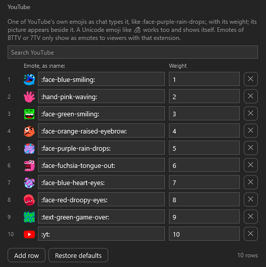
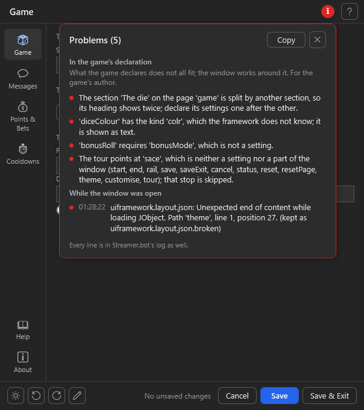

# Schema: what a game declares

The schema is everything the settings window needs to know about a game: the settings it reads, and the window
they are shown in. The game holds both in its host block (`stub/HostSchema.cs`, pasted into the game's action),
reads its values through the same table, and answers the window's `describe` request with the whole thing as
JSON. Values never sit in the schema, only in the settings file.

```json
{
  "host": "blackjack",
  "version": "v17.0.0",
  "settingsFile": "Chat Games/Blackjack Game/BJG-Settings.json",
  "settings": [ { "key": "...", "default": ..., "kind": "...", ... } ],
  "window": { "title": "Blackjack Game", "pages": [ ... ], "help": [ ... ], ... }
}
```

The host block builds this from two declarations:

```csharp
public static readonly UiWindow Window = new UiWindow("Blackjack Game", releases: "aaskjer/Blackjack-Game")
    .Pages(P("table", "Table", "cards"), P("stats", "Stats", "trophy", "leaderboard*", "resetLeaderboard"), "messages", "log", "help", "about")
    .Log("Chat Games/Logs", "BJG-log*.txt", writeLogKey: "logToFile")
    .Help(H("Playing a hand", Cmd("!blackjack <bet>", "Deals you in."), "A hand ends when everyone stands or busts."));

public static readonly Setting[] Table =
{
    S("useBot", true),
    S("globalCooldown", 10),
    S("maxBet", 1000, page: "table", min: 1, help: "Per hand and player."),
    Msg("Wins", "msgWin", "@{user} wins {amount} {pointsName}!", "Win", "Sent when a hand wins.", new[] { "user", "amount", "pointsName" }),
};
```

Keys the conventions know (`conventions/keys.json`: `useBot`, `globalCooldown`, `blockedUsers`, ...) need nothing
but their default; label, help, kind, page and limits come from the conventions. Everything else says what the
conventions cannot know.

## A setting

| Field          | Required | Meaning                                                                                   |
|----------------|----------|-------------------------------------------------------------------------------------------|
| `key`          | yes      | camelCase; canonical for keys the conventions know, free otherwise                          |
| `default`      | yes      | a JSON value; without `kind` it decides the kind                                            |
| `kind`         | no       | one of the kinds below; derived from `default` when missing                                 |
| `page`         | no       | the page's id; the conventions or the window set it otherwise, the rest lands on `game`     |
| `label`        | no       | shown above the field; known keys take it from the conventions                              |
| `help`         | no       | one sentence under the field                                                                |
| `min`, `max`   | no       | for `int`, `long`, `double`, `duration`, `percent`: a number outside is saved as the nearest limit, and the field then shows that value; a `min` below 0 lets a whole-number field take a minus |
| `step`         | no       | the step of a `double` or a `slider`                                                         |
| `unit`         | no       | shown after the field (`s`, `%`, `px`)                                                      |
| `options`      | no       | the choices of `options` or a `slider`: `["a", "b"]` or `["a|Label A", "b|Label B"]`       |
| `placeholders` | no       | for `template`: the names without braces, shown as chips                                    |
| `section`      | no       | a heading; where it changes, a new section of the page begins                               |
| `group`        | no       | for `template`: the group in the message picker (host block: `group:` on `S()` as well as `Msg()`) |
| `factor`       | no       | for `percent`: stored = typed × factor (0.01 stores a fraction; default 1)                  |
| `unlimitedAtZero` | no    | for `int`/`long`: 0 in the field means "no limit" and is stored as MaxValue                 |
| `aliases`      | no       | old keys: the store reads them and writes the canonical key back. An alias with a dot (`PlatformEmotes.twitch`) takes the value out of an object of the old file; the object goes once it is empty, and the old value goes from it also when the file has the canonical key already. Two settings naming the same alias (one old switch that became two) both take its value, a dotted one too. An alias that is another setting's key is not moved (the check names it) |
| `aliasFactor`  | no       | multiplies the first alias's value on the move (a fraction to percent: 100)                 |
| `hidden`       | no       | true: no field, but the value stays in the file                                             |
| `confirm`      | no       | for `action`: a yes/no question before the game is asked                                    |
| `row`          | no       | the name of a row: settings that name the same row one after the other share one line of the page, whatever their kind (a bet, a role and a Try button; a button takes the width it needs, an answer `panel` goes under the row); without it numbers sit three to a line, switches two, everything else alone |
| `requires`     | no       | a `bool`'s key, or a condition on any field (`numberOfSlots>=5`, `cpBetMode=fixed`, `mode!=free`; `=`, `!=`, `<`, `<=`, `>`, `>=`): the field is greyed out while it does not hold; with `hide:` in front (`hide:questionSource=igdb`) it is hidden instead, and a section heading whose fields are all hidden hides with them. `!key` holds while a switch is off or a field (or a list) is empty. A key the window does not show (hidden by the user) is read from its saved value. A condition compares the value as it is stored, shown or not: a `percent` as its fraction (`reshuffleThreshold>=0.5` for 50 %), a `duration` in seconds, an "unlimited" 0 as the large number it is saved as. `<`, `<=`, `>`, `>=` need a number on both sides; the check names one that compares text |
| `showWhen`     | no       | the field is shown only while the condition holds, whatever its kind (a field, a switch, a note, a button, a list): `questionSource=igdb`; several values, one of which must be picked, `questionSource=opentdb|wikidata`; none of them, `questionSource!=custom|igdb`; several conditions that must all hold, `mixOwn && questionSource!=custom`; a switch that is off, `!useBot`. `requires` still greys out; both can be set |
| `shows`        | no       | on a dropdown: per option value the keys of the fields that option shows, `{ "igdb": ["igdbClientId", "igdbClientSecret"], "opentdb": ["cacheSize"] }` (host block: `shows: new[] { "igdb: igdbClientId, igdbClientSecret", "opentdb: cacheSize" }`). A field named by several options shows with any of them; a field with a `showWhen` of its own needs both |
| `masked`       | no       | true: a text field shown as dots, with an eye button that reveals it (a token, a client secret); the value is saved like any other |
| `readOnly`     | no       | true: shown, not editable (a status the game writes); `readonly` is read too (host block: `readOnly:` on `S()`) |
| `twitchOnly`   | no       | for `bool`: the switch carries a "Twitch only" pill                                         |
| `transient`    | no       | true: shown, never saved, never counted as a change; only a live snapshot for the game carries it (the inputs of a Try button) |
| `live`         | no       | for `action`: the game gets the values as they stand in the window, unsaved and transient ones included. On any other field: the game is asked whenever the field changes (`test` with the field's key and the live values), and `set` in its answer fills other fields (a preset slider that sets five numbers) |
| `panel`        | no       | for `action`: the answer is shown in a box under the button instead of the footer           |
| `auto`         | no       | for `action`: no button; the game is asked when the page is shown and shortly after every change in the window (odds that follow the settings) |
| `columns`      | for `list`, `table` | `"key|kind|label"` per column; kinds `string`, `text` (multi-line, double width), `int`, `double` (half as wide), `bool`, `emote` (a text field with the picture beside it; a fourth part `|twitch`, `|youtube` or `|kick` says where the picture comes from: Kick from `[emote:ID:name]` or the short `ID:name`, Twitch by name from Twitch/7TV/BTTV/FFZ with what the game's `emotes` answer lists, YouTube's own emojis by their `:name:` from a table inside the DLL, a Unicode emoji shows itself). A trailing `|readonly` (`readOnly: true` in JSON) makes a column the game fills and the user only reads; a flag right after the kind (`"wins|int|readonly"`, `"face|emote|twitch"`) leaves the key as the header. A number column takes only a number: anything else puts the cell back to what it held. From eight rows a list gets a search box that hides the rows the text does not occur in |
| `file`         | no       | a file next to the settings file that holds this value instead (a word bank, a question list); relative or absolute |
| `field`        | no       | with `file`: the property in that file that holds the value; without it the file itself is the value |
| `platform`     | no       | for `emote`: `twitch`, `youtube` or `kick`, where the picture comes from                     |

Without `kind`: bool → `bool`, whole number → `int` (`long` when it does not fit an int, also where the conventions
say `int`), decimal → `double`, string → `string`, array → `list` (which then needs `columns`).

A value in the settings file that does not fit its field never stops the window from opening: a number field whose
value is no number (`""`, `"abc"`) shows its default, a number stored as text is read (`"0,5"` is 0.5, from a German
Windows), and a whole-number field holding a fraction shows it as it is, so the check before saving names it instead of
cutting it. A dropdown or a slider over stops whose stored value none of its options has keeps it as an extra entry
(the slider names it beside its label) and saves it back unchanged until the user picks another. Numbers are written
and compared with a point whatever the system's language.

## Kinds

| Kind        | Default     | Control                                    | Notes                                                 |
|-------------|-------------|--------------------------------------------|-------------------------------------------------------|
| `bool`      | bool        | toggle                                     |                                                       |
| `int`       | int         | number field; with `options` a dropdown    | `min`, `max`, `unit`, `unlimitedAtZero`                |
| `long`      | long        | number field                               | like `int`, for big balances                          |
| `double`    | double      | number field; with `options` a dropdown    | `min`, `max`, `step`; dot or comma; `1,000` and `1.000,5` are refused as ambiguous |
| `percent`   | int/double  | number field 0 to 100 with `%`             | stored as the number, not a fraction (see `factor`)   |
| `duration`  | int         | number field with a unit                   | stored in whole seconds; `unit` `min` or `h` types and shows minutes or hours (1.5 min is saved as 90), `s` or none seconds; `min`/`max` are seconds |
| `string`    | string      | one-line text field                        | saved as typed, spaces at either end included (a prefix `"🎲 "`) |
| `text`      | string      | multi-line text field                      |                                                       |
| `template`  | string      | multi-line, placeholder chips, chat preview| `placeholders`; the preview fills them with samples   |
| `options`   | string      | dropdown                                   | `options` required                                    |
| `namelist`  | string      | chips, Enter adds one                      | stored comma-separated                                |
| `grouplist` | string      | chips with Streamer.bot's groups suggested | stored comma-separated                                |
| `path`      | string      | text field with a folder/file dialog       | relative to the Streamer.bot folder is fine           |
| `colour`    | string      | colour field with a picker                 | `#rrggbb` or `#aarrggbb`                              |
| `emote`     | string      | text field with the emote's picture beside | `platform` says `twitch`, `youtube` or `kick`; Twitch's global emotes show without a Twitch login, the channel's once Streamer.bot has one |
| `slider`    | string/int/double | slider                               | with `options` a slider over the stops (the stop's value is stored, the labels sit under the stops); otherwise from `min` to `max` in `step`, the value beside the label; a default with a decimal makes it a `double` |
| `list`      | array       | row editor: a cell per column, remove, *Add row*, *Restore defaults*; with a `text` column or more than three columns a table instead, edited in place: one line per row, a click into a cell edits it, a `bool` column is a checkbox in every row, a search box above, Delete removes the picked rows | `columns` required; empty rows are dropped on save; with `file`/`field` in a file of its own; in the table a row keeps the properties no column shows |
| `table`     | array       | a table, read-only                         | for statistics the game writes; rows from the game's `table` answer |
| `note`      | –           | a paragraph on the page (`help`)           | no value; explains what follows; http(s) addresses are links |
| `action`    | –           | a button                                   | no value; asks the game (`test` with the key); the answer is the footer line, with `panel` a box under the button, with `live` from the current values, with `auto` without a button and by itself. See *Answers* below |

<p align="center"></p>
<p align="center"><sub>A <code>list</code> with an <code>emote</code> column and a number column (Slot Machine's YouTube reels).</sub></p>

### Answers of an action

The game answers `test` with a line of text, or with a JSON object:

```json
{
  "lines": [ "Jackpot every 2,400 spins.", { "text": "27 %", "big": true },
             { "emotes": ["Kappa", "LUL"], "platform": "twitch", "text": "The slots" } ],
  "bar": [ { "label": "Win", "value": 27, "text": "27 %", "colour": "#16a34a" }, { "label": "Loss", "value": 73 } ],
  "set": { "gridSize": 8, "shipCarrierEnabled": true },
  "status": "Fleet preset applied."
}
```

- `lines` are drawn one under the other; a line with `emotes` shows them as pictures with their names beneath
  (YouTube as the emoji), after its `text` when there is one.
- `bar` is a stacked bar with a legend.
- `set` puts values into other fields of the window as if typed (nothing is saved until Save: a preset button); a
  field whose value changes glows in the accent colour for a moment. A `list` takes its rows as an array (or
  the JSON text of one), so an import can fill the list it merged into.
- `status` is the line for the footer.
- `clipboard` is text the window puts on the clipboard (an overlay URL): the game runs on Streamer.bot's thread,
  which has no clipboard, the window's has.

## The window

The window declaration says how the window is called and laid out: what used to be a spec JSON in the settings
action. Everything is optional; a page a setting names but the window does not is made up on the way, `messages`
appears once there are templates. `help`, `log` and `about` sit together at the foot of the rail, in that order
whatever order the game declares them in (a page of the game's own with `bottom` goes above them).

```csharp
public static readonly UiWindow Window = new UiWindow("Blackjack Game", releases: "aaskjer/Blackjack-Game", logo: "https://…/logo.png")
    .Pages(P("table", "Table", "cards"), P("stats", "Stats", "trophy", "leaderboard*", "statsTable", "resetLeaderboard"), "messages", "log", P("help", "How to play"), "about")
    .Log("Chat Games/Logs", "BJG-log*.txt", writeLogKey: "logToFile", columns: new[] { "Player|User", "Bet" }, results: new[] { "Win", "Loss", "Push" })
    .Cooldowns(C("dc2d4f17-…", "globalCooldown", "userCooldown"))
    .Pill("freeGame", "Free game on", "Free game off", tooltip: "While it is on, nobody stakes or wins anything.")
    .Senders(cooldownGroup: "Cooldown")
    .Samples("user", "alice", "bet", "1,500", "cards", "🂫(10) 🂺(10)")
    .Answer("resetLeaderboard", "The leaderboard is empty.")
    .Override("egg", hidden: true)
    .Help(H("Playing a hand", Cmd("!blackjack <bet>", "Deals you in."), "A note.", Link("Guide", "https://…")))
    .About(credits: "Responsible: aaskjer", links: new[] { Link("Discord", "https://…") });
```

| Part                 | Meaning                                                                                              |
|----------------------|------------------------------------------------------------------------------------------------------|
| `UiWindow(title, …)` | the window title and About heading; `releases` is `owner/repo` on GitHub (repository and releases links, the update check); `logo` a URL; `logPrefix` for the framework's log lines (default `[Title/Settings]`); `width`, `height` |
| `Pages(…)`           | the pages in order: `P(id, title, icon, fields…)` or the id of a standard page (`messages`, `log`, `help`, `about`). `icon` is an emoji or a conventions name (`gear`, `dice`, `coins`, `clock`, `shield`, `chat`, `trophy`, `monitor`, `list`, `book`, `info`, `cards`, `chart`, `gift`). `fields` are keys or patterns like `overlay*` the page claims ahead of their own page; a pattern never takes a template off the Messages page, a full key does (it is then that page's field, not an entry of the Messages picker); a field the user moved to another page in the customise mode stays there |
| `Log(folder, files, …)` | the Log page: the folder (relative to the Streamer.bot folder) and the files in it (`BJG-log*.txt`), which the settings action reads and the page follows as they change; `writeLogKey` the bool behind "Write a log file per day", `writeLogHelp`, `columns` after Time and Result as `"Header|field"` (a field may name several keys, `"Word|Word,Word was"`: the first the line has is shown), `results` for the filter, `platforms`, `emptyText`. Headers and `emptyText` translate through `Tx`. The page reads lines as `[yyyy-MM-dd HH:mm:ss] RESULT \| User: name \| Platform: twitch \| Key: value \| …`, and older lines in columns (`yyyy-MM-dd HH:mm:ss RESULT  user  [R1\|id] Key: value \| …`) as well |
| `Cooldowns(C(command, global, user), …)` | commands whose cooldowns follow settings: the settings action sets them in Streamer.bot after every save. The command by its id (right-click the command in Streamer.bot, *Copy Id*; an import keeps it, so it is the robust way), or by its text (`!roll`) or name for a command made by hand; `global` and `user` are the keys of the two durations, either may be null |
| `Pill(key, on, off, tooltip)` | a pill in the header that follows a bool setting                                             |
| `Senders(…)`         | the keys of the sender switches on the Messages page where they differ from the conventions' (`useBot`, `sendAction`, `cooldownUseBot`, `cooldownSendAction`, `numberSeparator`); null hides one; `cooldownGroup` names the group the cooldown senders sit in |
| `Samples("k", "v", …)` | fixed sample values for the chat preview's placeholders; live ones (`pointsName`, `amount`, `min`, `max`) the window adds |
| `Answer(action, text)` | what an action would answer, for the framework's preview and screenshots only                      |
| `Override(key, …)`   | `page`, `label`, `help`, `section`, `hidden`, `order` of one setting, where the table should not say it |
| `Help(H(heading, lines…), …)` | the Help page: a line is a note (a string), `Cmd(command, what)` or `Link(text, url)`         |
| `Lang(code, texts…)` | the game's own texts in another language (see *Languages* below): `K(key, label, help)`, `Pg(id, title)`, `Tx(declared, translation)`, `Ui(key, text)` for the window's own texts, `Ph(placeholder, help)`. A language with a conventions file is offered anyway; `Lang` adds the game's words to it, or offers a language the framework does not have |
| `Lock()`             | locks the layout: no customise mode (the pen button is gone, and with it export and import), and a user's renames, moves, hidden fields and accent colour in `uiframework.layout.json` are not applied. The theme stays the user's, and so does the language, picked in the footer when the game offers more than one. In the schema `"locked": true` |
| `About(credits, sections, links, streamerBotLink, authorLink, defaultLinks)` | the About page: the game's credits under its name (none unless given; `Tx` translates them), sections like help, the game's own links. It ends with the framework's links from `conventions/keys.json` (`about.links`: the UIFramework page, Streamer.bot, *Report something that looks wrong*, which goes to the game's issues when it names its repository, else the framework's); `defaultLinks: false` leaves them out, `streamerBotLink: false` only that one. `authorLink` does nothing any more. The framework's logo sits faint in the page's bottom right corner (its tooltip names the version, a click opens the framework's page); a game cannot remove it. In the schema `about: { credits, sections, links: [ { text, url } ], defaultLinks, streamerBotLink }` |
| `Tour(Tip(target, title, text), …)` | a tour of the window that starts by itself on its first open; see *The tour* below |

### The search

Every window can be searched: **Ctrl+F**, or the magnifier at the top right, opens a bar under the header. It finds

- **settings**, by their label, their help, their section, their page and their key;
- **messages**, by their label, their group and their help;
- **pages**, by their title.

Every word typed has to occur, in any order, whatever the case and the accents (`uber` finds *Über*, `grosse`
finds *Größe*). A word that starts the label ranks before one inside it, before one in the section or the key,
before one only the help has. Up and Down move through the results, Enter or a click goes there: the page comes to
the front, the field scrolls into view, is ringed in the accent colour for a moment and gets the cursor; a message
is selected on the Messages page. Esc or a click beside the bar closes it. A game declares nothing for this; a
setting it hides, or one a condition hides right now, is not found. `Tip("search")` puts the magnifier into the
window's tour.

Other keys of the window: **Ctrl+S** saves, **Ctrl+1** to **Ctrl+9** and **Ctrl+0** go to the first ten pages.

### The tour

A window can explain itself: on its first open the tour dims the window, rings one part at a time and says what it
does beside it, with *Back*, *Next* and *End tour* (Esc ends it, the arrow keys and Enter step through it). Afterwards
`"tourSeen": true` in `uiframework.layout.json` keeps it from starting again, and the **?** at the top right of the
window shows it whenever the user wants. A window without a tour has no **?**.

```csharp
    .Tour(
        Tip("start"),                                            // the framework's welcome, in the middle
        Tip("rail"),
        Tip("sides", "A setting", "Point at a field to read its help."),
        Tip("tryRoll", "Try it out", "Press Roll now; nothing goes to chat.", act: true),   // the user may press it
        Tip("page:messages"),
        Tip("save"), Tip("customise"), Tip("tour"),
        Tip("end", "Have fun", "Save, then type !roll in your chat."))
```

`Tip(target, title, text, act)` points at the target below. With `act: true` the user may use the ringed part while
the stop is up ("Try it yourself"): press the button, type into the field; the rest of the window stays out of reach,
and the ring follows the part as it grows (a Try button's answer). `Tip` points at:

| Target | Rings | Its own text when title and text are left out |
|--------|-------|-----------------------------------------------|
| a setting's key | the field, on its page (the page comes to the front) | the setting's label and help |
| `page:<id>` | the page's entry in the rail; the page itself stays bright | the page's title; for `messages`, `log`, `help` and `about` a line about the page |
| `rail`, `save`, `saveExit`, `cancel`, `status`, `reset`, `resetPage`, `theme`, `customise`, `tour`, `search` | that part of the window (`tour` is the **?** itself, `search` the magnifier, from 1.8.0) | the framework's, in the window's language |
| `start`, `end` | nothing: a note in the middle | the framework's welcome and goodbye |
| null | nothing: a note in the middle | none; give a title or a text |

A stop the window cannot show is left out: a page the user hid, a field hidden by the layout, `customise` in a locked
window. A target that is neither a setting, a page nor a part is listed under the red "i" like any other mistake in the
declaration. The game's own titles and texts translate through `Lang(code, Tx(declared, translation))` like every
declared text. In the schema: `window.tour: [ "start", { "target": "sides", "title": "…", "text": "…", "act": true } ]`;
a stop as a plain string is the target alone.

### Sections shown on a condition

A whole section, heading and fields, can depend on a dropdown or a switch: the window's `sections` name it by the
section its settings declare and give the condition, the same as a field's `showWhen`.

```csharp
    .Section("IGDB access", showWhen: "questionSource=igdb")
```

In the schema: `window.sections: [ { "name": "IGDB access", "showWhen": "questionSource=igdb" } ]`. A field's own
`showWhen` and its section's both have to hold. A field the user's layout moves to another section takes that
section's condition, not the one it was declared in. When the window opens, every condition is checked: a key that is
not a setting, or a value a dropdown has no option for (`questionSource=IGBD`), is listed under the red "i" in the header.

### Languages

What the game declares is English. When the layout file names another language (`de`, `es`), the window
translates what the conventions know: the texts of the conventions' keys (`conventions/lang/de.json`, `keys`)
replace a known key's label and help where the game left them out or declared the conventions' own English
wording; a label or help the game worded itself is looked up by that wording (`texts`, below), else the
conventions' translation of the key stands, and in a language the conventions do not translate it stays as the
game wrote it. Pages are titled by id (`pages`), and short declared texts are looked up
by their English wording (`texts`): section headings, pill texts, page titles, option labels, message groups,
list column headers, the log page's switch, and the help and about pages line by line (headings, notes, what a
command does, link texts). What nothing knows stays as declared. The user's own layout (a renamed field or page) still has the last word.

Every language there are texts for is offered, in the language picker by its own name (Deutsch, Español):
English, the languages the DLL carries (`conventions/lang/*.json`), a language file a user put into
`UIFramework\lang\` beside Streamer.bot (`es.json` there corrects or extends the DLL's, `nl.json` adds Dutch
without a release), and every language the game brings texts for with `Lang`. A game without texts of its own
gets what the conventions translate; its own wording stays English until it adds them. A game whose window names
its `language` has no picker.

A game adds what the conventions cannot know, its own keys and sections, with `Lang` on the window; several
calls add up, and these texts are laid over the conventions' for that language:

```csharp
    .Lang("de", K("numDecks", "Decks im Schuh", "Wie viele Decks der Dealer mischt."), K("egg", "Ei"),
                Pg("fleet", "Flotte"), Tx("Shoe", "Schuh"), Tx("Free game on", "Freispiel an"))
```

A `K` is the game's own translation of a key and replaces its label (and help) whatever the game declared;
`K(key, label)` without a help keeps the help the conventions have for the key. A conventions key the game gave
a label of its own is translated by a `Tx` for that label; without one it shows the conventions' text for the key,
and only a key the conventions do not translate either keeps the declared wording.

In the schema this is `lang: { "de": { "keys": …, "pages": …, "texts": … } }`, the shape of a conventions
language file. A game that wants its help and about pages in another language adds a `Tx` per heading and
line; a line without one stays English. For a language the framework has no file for, `Ui(key, text)` translates
one of the window's own texts by its key in `conventions/lang/en.json`'s `ui` section (`Ui("btn.save", "Opslaan")`)
and `Ph(placeholder, help)` a placeholder chip's help; what the game leaves out stays English.

Settings the window puts on a standard page (a switch on `log`) sit above that page's own content. Within a
page the table's order holds (`Override(order:)` moves one); a heading where `section` changes.

What the game declares is checked when the window opens: an unknown kind, a requirement on a key that is not a
setting, a page naming a pattern no setting matches, a minimum above a maximum, a section condition for a section
no setting is in, an old key (`aliases`) that is another setting's key, a known key of the conventions declared as
another kind of value (`maxBet` as `options`: it would still take their limits, old keys and translations), a
section split by another on its page (its heading would show twice), an icon name the framework does not know. A red **i** appears in the
window's header; a click opens a panel with every finding (and whatever failed while the window was open: a page
that could not be built, a failed save, an unreadable layout file), with *Copy* for a bug report. The pages show
none of it, and every line is in Streamer.bot's log as well.

<p align="center">
  
</p>

A settings action that carries a spec of its own (the JSON with the same parts as the builder, see the git
history of `docs/Spec.md` and `stub/Stub.spec.cs`) wins over the window in the schema.

## The game's side

`UiHost.Handle(args, CPH, actionName, host, version, settingsFile, …)` is the first thing the game's action calls.
It answers the settings action's requests and returns true, so the action returns at once; otherwise it returns
false and the game plays. Every request must leave the game as it was: no chat output, no state written. The
request comes in the arguments `uiframework.request`, `uiframework.name`, `uiframework.values` and
`uiframework.var` (the global the answer goes into, so the name the game knows itself by never matters); the
describe answer leaves a line in Streamer.bot's log.

| Request    | When                                     | The game's part                                                     |
|------------|------------------------------------------|---------------------------------------------------------------------|
| `describe` | the window opens                         | nothing: `UiSchema.ToJson` answers with the table and the window    |
| `test`     | a Try button, a live field, an auto action | `test: (name, s) => …` answers by the setting's key with the window's current values; null for "no answer" |
| `validate` | before a save                            | `validate: s => …` answers the problems one per line ("Minimum bet is above the maximum"), or null; the window shows them and asks whether to save anyway |
| `saved`    | after a save, with the saved values      | `saved: s => …` writes an overlay, restarts a timer; the cooldowns the window declares are set by the settings action before this |
| `table`    | a `table` field is shown                 | `table: key => …` answers a JSON array of objects whose fields the columns name |
| `emotes`   | the window opens, for emote pictures     | `emotes: () => …` answers the sources as JSON: `{ "twitch": { "channelId": "…", "sources": ["twitch", "7tv", "bttv", "ffz"] }, "youtube": { ":name:": "picture url" } }`; the `youtube` object adds to or replaces entries of the built-in table of YouTube's own emojis |

**The points system.** `UiCurrency.Detect(CPH, settings)` gives the user variable the points live in
(`Variable`), what they are called (`Name`) and where that came from (`Source`): StreamUP's Currency Core
(`currency_ProductSettings`) or Tawmae's LOYALTY POINTS (`tawmae_Settings_LOYALTY POINTS`) when one is installed,
else the settings `pointsVariable` and `pointsName` (declare both; they are conventions keys with a page of their
own). Detect on every run. The describe answer carries a detected system as `currency`, and the window shows it
as a pill (`Currency Core: points`) and says on the two settings that they are the fallback. Reading and
writing a viewer's points stays the game's: `CPH.GetTwitchUserVarById<long>(userId, currency.Variable, true)` and
`SetTwitchUserVarById` (the YouTube and Kick ones likewise); both systems keep the balance right there.

The values arrive as `UiSettings` with `Bool`, `Int`, `Long`, `Double`, `String`, `Ceiling` (0 as "no limit"),
`Clamp` and `Raw` (the JSON object). `UiSettings.Load(path)` reads the settings file the same way, old keys
through the aliases; a relative path starts in the Streamer.bot folder. A file that cannot be read gives the
`.bak` of the window's last save, else the defaults, and `Problem` says so (`FromBackup` which);
`UiSettings.Load(path, CPH.LogWarn)` also logs it.

**A file of its own (`file`, `field`):** the value is read on open from `<folder of the settings file>\<file>`
(the property `field`, or the file itself) and written back there on save, atomically with a `.bak`; the rest of
the file stays. The key never enters the settings file; *Reset all* resets only the settings file (the settings the window
shows: hidden and read-only ones, those on a page the user hid and keys it has no field for keep their values) and leaves
this one (its editor has *Restore defaults*). A missing file shows the `default`, so the file the game reads
anyway (`RT-wordbank.json`) stays the only copy. A save writes the file only when its value changed, so a list the
game added to while the window was open keeps those entries; a value an older version kept in the settings file
moves into the file with the first save.

## Update notice

Streamers who do not open the settings every day still hear of updates: once per Streamer.bot start, one notice
names what is new, for example *🔔 Updates are out: Hangman Game v13.2.0, UIFramework v1.4.0. Details are in
Streamer.bot's log.* The log has one line per update with its link.

- **Start it from `Init()`.** Call `UiUpdateNotice.Startup(CPH, ActionName, "mygame", CurrentVersion, SettingsFile)`
  in the game action's `Init()` and tick *Precompile on Application Start* on its Execute Code sub-action:
  Streamer.bot then runs `Init()` as it starts. The notice runs in the background and never holds the action up.
- **What is in it:** each game that started this way (or whose settings were opened) whose newest GitHub release
  (`releases` of its window) is newer than the version it runs; UIFramework when its newest release is newer than
  the newest `UIFramework.dll` under `lib\`; and *import it again* for a game whose settings action is older than
  that release needs (`minHostStub`; the window notes the settings action's version when it opens).
- **When:** about 20 seconds after the first game starts, so every game that starts with Streamer.bot is in it,
  and once GitHub's answers are there (asked in the background at most twice a day, kept in
  `<Streamer.bot>\UIFramework\updates.json` for every game). Then nothing more until Streamer.bot starts again.
  Nothing new: no notice. Without the DLL (the settings never opened) there is none.
- **Where:** a line in every chat whose broadcaster account is connected (Twitch, YouTube, Kick; it waits up to a
  minute for the first one), as the bot when the game's `useBot` is on. While no broadcaster account is connected,
  a Windows notification instead.
- **How a game wants it,** in its window:

  ```csharp
  .Updates(chat: true, chatText: "🎲 {updates} - grab them on GitHub!", toast: true, toastAlways: false,
           toastTitle: "My Game", toastText: "New: {updates}")
  ```

  | Option        | Default | Meaning |
  |---------------|---------|---------|
  | `chat`        | `true`  | the line in every connected chat |
  | `chatText`    | the framework's, in the window's language | the line; `{updates}` is the list, `{count}` how many |
  | `toast`       | `true`  | a Windows notification |
  | `toastAlways` | `false` | `false`: only while no broadcaster account is connected; `true`: always |
  | `toastTitle`, `toastText` | the framework's | the notification's title and text, with the same placeholders |

  One game delivers the whole notice: games with the same texts share one line, a game with texts of its own gets
  its own; UIFramework goes with the game that delivers. In the schema: `window.updates`.
- **Turning it off as a streamer:** the switch *Tell me about updates* on a game's About page
  (`"updateNotices": false` in its `uiframework.layout.json`) leaves that game out.

A game gets this with the host block of UIFramework 1.4.0 or newer (`tools/update-host-block.ps1`). The host block of
1.3.0 asked on ordinary runs of the game instead; the DLL still answers it.

## A timed action

Streamer.bot's own timer dialog offers three ways to run a timed action: a fixed interval, a random one between two
bounds, and only after so many chat lines. Code can set only the interval and switch the timer on and off
(`CPH.SetTimerInterval`, `EnableTimerById`, `DisableTimerById`), so the host block keeps the random time and the
lines itself, in `UiTimer`. A game with rounds that start themselves declares five convention keys and makes four
calls.

| Key | Kind | Default | Meaning |
|-----|------|---------|---------|
| `autoStartEnabled` | bool | `false` | the timed action is on |
| `autoStartIntervalMinutes` | int | `15` | the wait; with a random time, the shortest one |
| `autoStartRandom` | bool | `false` | draw every wait anew, up to the maximum |
| `autoStartIntervalMaxMinutes` | int | `30` | the longest wait of a random time |
| `autoStartMinChatLines` | int | `0` | lines chat must have written since the last automatic start; 0 asks for none |

Declared with nothing but key and default, they get their page (`game`), labels and help in English, German and
Spanish from the conventions; the two intervals share a row and are greyed out with their switch.

```csharp
private const string AutoStartTimerId = "…";   // the timed action's id in the export

public void Init()
{
    _cfg = Settings.Load();
    UiTimer.Sync(CPH, AutoStartTimerId, _cfg.AutoStartEnabled, _cfg.AutoStartIntervalMinutes, _cfg.AutoStartRandom,
        _cfg.AutoStartIntervalMaxMinutes, log: m => CPH.LogWarn(m));
}

// saved: the window's hook after a save. restart: true, so a new schedule counts from the save.
private void WindowSaved(UiSettings s) =>
    UiTimer.Sync(CPH, AutoStartTimerId, …, restart: true);

public bool Execute()
{
    …
    if (CPH.GetEventType() == EventType.TimedAction)
    {
        UiTimer.Rearm(CPH, AutoStartTimerId, _cfg.AutoStartIntervalMinutes, _cfg.AutoStartRandom, _cfg.AutoStartIntervalMaxMinutes);
        foreach (string platform in connectedPlatforms)
            if (UiTimer.TakeLines(platform, _cfg.AutoStartMinChatLines))
                StartRound(platform);
        return true;
    }
    if (isChatMessage) UiTimer.NoteLine(platform);   // every chat line the action sees
    …
}
```

- **`Sync`** brings the timed action in line with the settings. A timer that already runs keeps its countdown, so a
  recompile does not push the next round out; `restart: true` switches it off and on, which starts the wait over.
  A timed action the import does not have is one line through `log`, never an exception.
- **`Rearm`**, once each time the timer fires: a random timer draws its next wait and starts over with it. A fixed
  one runs on untouched.
- **`NoteLine(scope)`** counts a chat line; **`TakeLines(scope, min)`** is true once a scope has its lines and
  starts its count over. False leaves the count, so the round waits for the next turn of the timer and the lines
  keep adding up, as Streamer.bot's own lines do. A scope is a platform, or `""` for a game with one chat.
- **`NextSeconds(minutes, random, maxMinutes)`** is the wait itself: at least a minute, at most a day; a maximum
  below the interval is the interval.

For the lines the game action needs the chat message triggers of the platforms it plays on (Twitch *Chat
Message*, YouTube *Message*, Kick *Chat Message*) next to its commands, and the export a timed action whose
trigger is on the game action. The counts live in memory: a recompile or a restart of Streamer.bot starts them over.
Trivia and Hangman run their automatic rounds this way.

### Only while live

Streamer.bot has no live status to ask, so `UiLive.Of(CPH, "twitch")` (or `"youtube"`, `"kick"`) finds out:
Twitch through its API with Streamer.bot's own token, YouTube by the broadcasts Streamer.bot monitors, Kick through
its public channel page. It answers `UiLiveState.Live`, `Offline` or `Unknown`, keeps an answer for half a minute and
never throws. `UiLive.SkipReason(live, recentChat)` is why something automatic should stay away, or null: offline
always keeps it away, and a platform that could not say goes by whether its chat has been heard lately.

```csharp
string skip = UiLive.SkipReason(UiLive.Of(CPH, platform, m => CPH.LogWarn(m)), UiTimer.LinesSince(platform) > 0);
if (skip != null) continue;
```

Twitch and Kick are asked by UIFramework.dll 1.6.0 or newer, because the block itself must compile in an action
that references nothing but mscorlib and System.Core. Without the DLL (the settings never opened) or with an older
one they are `Unknown`, which `log` is told once.

### Twitch's ad breaks

While ads run, viewers cannot see the stream, but chat works as ever: a good moment for a round. Streamer.bot has
two triggers for it under Twitch, Ads: *Ad Run* when ads start, with their length in `adLength` (seconds), and
*Upcoming Ad*, every minute from five minutes ahead, with `minutes` and `adLength`. It has none for the end, so
`UiAdBreak` takes the break as over once its length has passed. The game action needs both triggers.

| Key | Kind | Default | Meaning |
|-----|------|---------|---------|
| `adBreakStart` | bool | `false` | start a round when ads start |
| `adBreakAnnounce` | bool | `true` | a line in chat ahead of the ads |
| `adBreakAnnounceMinutes` | int | `1` | how long ahead, 1 to 5 |
| `adBreakBonusPercent` | percent | `0` | how much more a round started during ads pays |
| `adBreakOnly` | bool | `false` | viewers start rounds only during ads |

They sit on the conventions' page `automation` (*Automation*), where the timer's keys are too; a game lists it
among its pages (`P("automation", "Automation", "⏱️")`).

```csharp
EventType evt = CPH.GetEventType();
if (evt == EventType.TwitchAdRun)
{
    int seconds = UiAdBreak.Begin(args, () => CPH.TriggerCodeEvent("demo_onAdBreakEnd", false));
    if (seconds > 0 && _cfg.AdBreakStart)
        StartRounds("twitch", UiAdBreak.RoundsThatFit(seconds, roundSeconds, pauseSeconds, most));
    return true;
}
if (evt == EventType.TwitchUpcomingAd)
{
    if (_cfg.AdBreakAnnounce && UiAdBreak.Announce(args, _cfg.AdBreakAnnounceMinutes, out int minutes, out int seconds))
        Say("Ads in " + minutes + " min: a round starts with them.");
    return true;
}
```

- **`Begin(args, ended)`** opens the window for the event's `adLength` and answers that length; 0, and no window,
  when the event carries none. `ended` runs once when the time has passed, unless another break or `End()` came first.
- **`Active`**, **`SecondsLeft`**, **`Length`**: whether ads run now, for how long still, and how long the last
  break was. A game reads `Active` where a round starts, for the bonus and for `adBreakOnly`.
- **`Announce(args, minutesBefore, out minutes, out seconds)`** is true once per ad break, when it is that near
  (1 to 5 minutes): Streamer.bot fires every minute, and one line in chat is enough.
- **`RoundsThatFit(adSeconds, roundSeconds, gapSeconds, most)`**: at least one, however short the ads.
- **`WithBonus(factor, bonusPercent)`**: the payout factor with the bonus on top.

The window lives in memory: a recompile closes it. Trivia and Hangman use it.

## Custom triggers and methods

What a game offers the streamer's own actions is declared once, in the window:

```csharp
.Trigger("Demo: Free Game Start", "demo_onFreeStart", "Free game was switched on.")
.Triggers(new[] { "roundOutcome=WIN", "roundWinner=alice", "roundPoints=500", "roundBlitz=false" },
    Tr("Demo: Round Won",  "demo_onWin",  "Somebody won the round."),
    Tr("Demo: Round Lost", "demo_onLoss", "Nobody did.", "roundOutcome=LOSS", "roundWinner=", "roundPoints=0"))
.Method("StartRound", "Starts a round. Returns false when none started.",
    "demoPlatform=in: twitch, youtube or kick", "demoStarted=out: whether a round began")
```

- **`Trigger(name, code, what, args…)`**: the name Streamer.bot shows, the code `CPH.TriggerCodeEvent` takes, what
  it is for, and the arguments it carries, each `"name"` or `"name=sample value"`.
- **`Triggers(shared, Tr(…), …)`** for triggers that carry the same arguments, every way a round can end: the
  shared ones once, then each trigger with what is its own. An argument a trigger names itself replaces the shared
  one of that name, or is added after them.
- **`Method(name, what, args…)`**: a public `bool` method of the game action for an *Execute C# Method*
  sub-action, with the arguments it reads and sets, each `"name=what it is"`.

From that one list:

- **`UiTriggers.Register(CPH, "Chat Game", "Demo Game")`** in `Init()` registers every trigger under those
  categories. No `CPH.RegisterCustomTrigger` line of the game's own is left to forget.
- **The Help page** ends with *Custom triggers* (each with its arguments and sample values) and *Methods for your
  own actions*, in the window's language; a game with no help of its own gets the page for them.
- **Fire with sample values**, a button under each trigger, has the game fire it once with the samples as
  arguments, so a streamer can try an action of their own without playing a round. A sample that reads as a whole
  number or as `true`/`false` is passed as one. The host block answers this itself (`UiHost.Handle`); the game's
  `test` is not asked. A game with an older host block does not answer, and the window says so.

The game still fires its triggers itself where its rounds end. In the schema: `window.triggers` and
`window.methods`.

## Export and import

The customise mode's bar (the pen, bottom left) has *Export* and *Import*: Export writes the saved settings
(transient ones left out, values from files of their own included) as
`{ "uiframework": "settings", "host", "version", "exported", "settings": { … } }` to a file of the user's
choosing; Import replaces the saved settings, after asking, with such a file or a settings file itself (old keys
through the aliases, read as the settings file is read), keeps the file as it was as `.bak` and rebuilds the window
on them. What the imported file does not name keeps its value, also what the game wrote while the window was open.
A file of another host asks; what the window does not know is skipped.

Tooltips have a fixed width and wrap instead of running across the screen.
